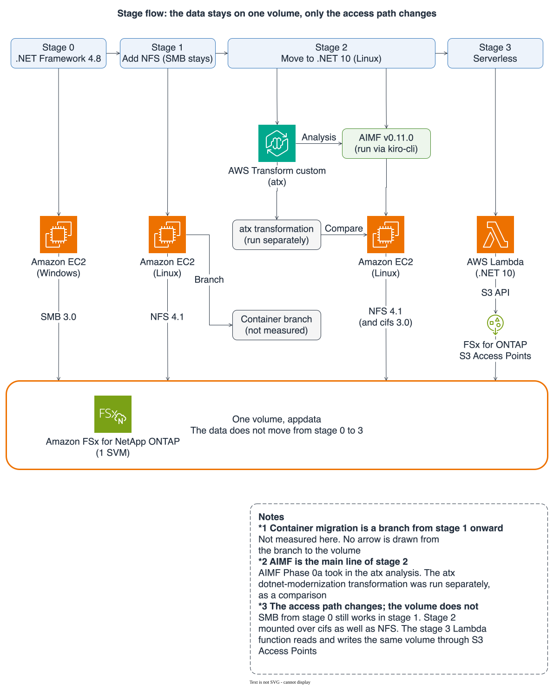

# Reproduction guide: reproducing stages 0 to 3 in order

> Evidence tier: this document is a procedure. The result of each step depends on the measured values in
> [stage 0](stage-0-smb-ntfs.md), [stage 1](stage-1-multiprotocol.md),
> [stage 2](stage-2-aimf-modern-dotnet.md), [stage 3](stage-3-s3-access-points.md), and the
> [verification environment](environment.md). Commands that use repository scripts were written to match
> `--help` and the header comment of each script. As of 2026-10-13, the published `scripts/measure/`
> drivers, `scripts/fetch-prices.py`, and `app/modern/` have not been re-run against the environment,
> which has been deleted (unit tests and static checks pass). Steps marked "reconstructed" are manual
> procedures assembled from the run notes and are not scripted.
> IDs are written as placeholders such as `fs-0123456789abcdef0`, `123456789012`, and `<management-ip>`.

This guide gives the order for reproducing, with the published scripts and apps, the verification
(2026-10-07 to 2026-10-12, ap-northeast-1) that moves a .NET Framework app on Windows to .NET on Linux
and then to AWS Lambda, using one volume of Amazon FSx for NetApp ONTAP (FSx for ONTAP below).
It does not promise that a reproduced result matches the original record. Candidate reasons for a
mismatch are in "What cannot be reproduced".

## Scope that can and cannot be reproduced

| Item | Reproducible from the public repository | Means | Limit |
|---|---|---|---|
| Creating and deleting the base stack | Yes | `scripts/estimate.py`, `scripts/deploy.sh`, `scripts/teardown.sh` | Estimate unit prices change with the read date. The ONTAP version can differ at each build |
| ONTAP configuration and boundary records | Yes | `scripts/ontap/*`, `scripts/check-invariant.py` | Placing files on hosts and collecting results are manual (reconstructed) |
| Building the legacy app and running the Probe (Windows, Linux cifs and NFS) | Partly | `app/legacy`, `scripts/run-probe.sh` | The Windows build and placing the launcher are manual (reconstructed) |
| 8-pair cross-host measurement | Yes | `scripts/run-probe.sh`, `scripts/measure/pairs.py`, `scripts/probe_merge.py` | One observation per pair. The numbers will not be identical |
| Building and testing the modernized app | Yes | `app/modern`, `make app-modern` | 54 tests passed once on macOS with SDK 10.0.400 |
| Placing the modernized app on the Linux host | Conditional | `scripts/measure/ship_build.py` | Delta shipping is practical only when the host already has an earlier build. The first shipment goes through S3 and is not scripted |
| Worker output comparison (legacy Worker and modernized Worker) | Yes | `scripts/measure/host/run-worker.sh`, `windows/*.ps1`, `compare_worker_out.py` | The two Windows scripts cannot be passed through ssm_run.py directly (see "Known limits") |
| AIMF session | The procedure can be reproduced | `scripts/aimf/*`, kiro-cli | Output is not deterministic. The approver script is not published |
| The two AWS Transform custom (atx) transformations | The procedure can be reproduced | `scripts/aimf/run-atx.sh` | Output and agent minutes differ from run to run |
| Stage 3 (Lambda and S3 Access Points) | Yes | `app/modern/src/DocIntake.Lambda`, `scripts/deploy.sh stage3`, `scripts/measure/lambda_invoke.py` | `lambda_invoke.py` has not been run in this form |
| Price fixtures for estimates | Yes | `scripts/fetch-prices.py` | The filter values were not re-checked against a live environment |
| Invoiced amounts | No | None | Invoiced amounts were not observed. Estimates only |

## Assumed accounts, tools, and versions

AWS-side prerequisites:

- An account and permissions that can create FSx for ONTAP, AWS Managed Microsoft AD, EC2, Lambda,
  Systems Manager, Secrets Manager, CloudFormation, and S3 in ap-northeast-1. The minimum set of required
  permissions has not been verified
- A signed-in IAM Identity Center (SSO) session. On `Token has expired`, the reader runs `aws sso login`.
  The scripts do not try another authentication path. Do not create long-lived access keys
- A newly created file system for the verification. Do not use an existing production volume

Tools to install on the local terminal. Each version is paired with where it comes from.

| Tool | Version | Source |
|---|---|---|
| Python | 3.12 or later (CI uses 3.12) | `.github/workflows/ci.yml` |
| ruff, cfn-lint | 0.16.7, 1.56.3 | `requirements-dev.txt` (`make install`) |
| markdownlint-cli2 | 0.22.1 | `ci.yml` |
| gitleaks | 8.30.1 | `ci.yml` |
| cfn-guard | 3.2.0 | `ci.yml` |
| shellcheck | Version not pinned | `ci.yml` (apt package) |
| .NET SDK | 10 (build confirmed with 10.0.400) | `make app-modern` rejects anything other than 10.x |
| AWS CLI | v2 (uses `--cli-binary-format`) | The version was not recorded as of 2026-10-13 |
| kiro-cli | 2.29.1 (V2 engine, interactive mode) | [Stage 2](stage-2-aimf-modern-dotnet.md) |
| atx | 3.18.0 | [Stage 2](stage-2-aimf-modern-dotnet.md) |
| AIMF | v0.11.0 | Pinned by `scripts/aimf/setup-workspace.sh` |
| tmux | Version not recorded | Used to drive the AIMF session |
| pandoc | 3.12.1 (installed while preparing AIMF) | Preparation record of 2026-10-12 |

atx is the CLI for AWS Transform custom. On 2026-10-10 it was confirmed that the ap-northeast-1 registry
lists two transformations. Using kiro-cli requires credits.

## Overall flow and run id naming

Each stage builds on the configuration of the previous one. The single volume `appdata` is never moved.

| Stage | What runs | What you get | Where the record goes |
|---|---|---|---|
| Preparation | `fetch-prices.py`, `estimate.py`, `deploy.sh base` | Base stack `appmod-base` | `.private/estimates/`, `.private/runs/approval.json` |
| 0 | `ontap/stage0-smb.sh`, build of the legacy app, `run-probe.sh --stage 0` | Boundary record `b0`, merged results for 4 Probe pairs | `.private/runs/s0-<UTC>/` |
| 1 | `ontap/stage1-nfs.sh`, `run-probe.sh --stage 1` | Boundary record `b1`, merged results for 8 pairs | `.private/runs/s1-<UTC>/` |
| 2 | The two atx transformations, the AIMF session, placing and measuring `app/modern` | ADRs, the modernized app, Probe and Worker results on Linux | `.private/aimf/`, `.private/runs/s2m-<UTC>/` and others |
| 3 | `deploy.sh stage3`, `lambda_invoke.py` | `appmod-stage3`, Lambda worker and probe results, `b3` | `.private/runs/s3m-<UTC>/` |



Dark version: [SVG](../_assets/images/appmod-stage-flow-en-dark.svg) / [PNG](../_assets/images/png/appmod-stage-flow-en-dark@2x.png). Light version as PNG: [PNG](../_assets/images/png/appmod-stage-flow-en@2x.png).

The table below carries the same content as the figure; no fact appears only in the figure.

| Stage | Runtime | Access path | Reach to the volume |
|---|---|---|---|
| 0 | Windows EC2, .NET Framework 4.8 | SMB 3.0 | The same volume, `appdata` |
| 1 | A Linux EC2 instance added to stage 0; SMB continues | NFS 4.1 | The same volume, `appdata` |
| 2 | Linux EC2, .NET 10. AIMF v0.11.0 run through kiro-cli, with the atx analysis as input | NFS 4.1 and cifs 3.0 | The same volume, `appdata` |
| 3 | AWS Lambda, .NET 10 | S3 API to FSx for ONTAP S3 Access Points | The same volume, `appdata` |
| Branch | Container migration (a branch from stage 1 onward) | Not measured here | No arrow is drawn |

The atx dotnet-modernization transformation was run separately from AIMF, as a comparison. AIMF Phase 0a took in the atx analysis. The data does not move from stage 0 to 3; only the access path changes.

A run id has the form `s<stage digit>[0 to 2 lowercase letters]-<UTC as YYYYMMDDTHHMMSSZ>`. The drivers and
the host-side scripts reject a value that does not match this form. Build the UTC part with
`date -u +%Y%m%dT%H%M%SZ`.

| Prefix | Meaning |
|---|---|
| `s0`, `s1` | Stage 0 and stage 1 measurements with the legacy Probe |
| `s0w` | The baseline `out/s0/` produced by running the legacy Windows Worker once |
| `s2`, `s2f`, `s2g` | Records of running the atx transformation output on Linux (for comparison) |
| `s2m` | Probe, Worker, and 8-pair cross-host runs of the AIMF-derived modernized app |
| `s2n` | Re-measurement of the acl-evaluation record in the ADR-3 shape |
| `s3`, `s3b`, `s3m` | Stage 3. `s3b` is the case-sensitivity re-measurement, `s3m` is the AIMF-derived code |
| `s4c` | A run that measured case-sensitivity with a positive control on Windows SMB, Linux cifs, and Linux NFS |

## Preparing the working repository

```bash
git clone https://github.com/Yoshiki0705/FSx-for-ONTAP-App-Modernization-Patterns.git
cd FSx-for-ONTAP-App-Modernization-Patterns
make install
make all > /tmp/all.log 2>&1; echo $?
```

`make all` runs the static checks for Python, shell, CloudFormation, and Markdown, the unit tests, and the
build and test of `app/modern`. A check fails when its tool is missing. Read the result from the exit
code and do not pass it through a pipe.

`.private/` is a gitignored working area that holds estimates, approval records, run records, and the
AIMF workspace. It contains account IDs and instance IDs, so do not send it to a public repository.

`scripts/create-secrets.sh` and `scripts/aimf/setup-workspace.sh` print usage on `-h` or `--help` and exit 2
on any other argument, before any path or AWS call. On a first run, add `APPMOD_DRY_RUN=1` to check what would run.

## Estimate, approval, and creating the base

Before any operation that incurs charges, create an estimate, have a human approve it, and run the
operation tied to that approval record. `deploy.sh` rejects an estimate older than 24 hours, and a used
estimate moves to `.private/estimates/used/`, so it cannot be used for a second operation.

1. Re-fetch the price fixture. This only reads the Price List API and leaves the SKU and read date in the file. Unit prices change, so re-fetch at every approval.

   ```bash
   python3 scripts/fetch-prices.py --set all --out .private/estimates/fixtures/prices.json
   ```

   `--set` takes `base`, `atx`, `stage3`, or `all`. When a key's price is not uniquely determined, the
   script stops with exit code 3 and prints the candidates. `--explain <key>` shows only that key's
   candidates. If the actual value is 10 times or more away from the reference value, the exit code is 4.
   An expired SSO session gives exit code 20.

2. Write the file with the minimum storage and throughput. Read the current minimum for first-generation
   Single-AZ from the FSx for ONTAP quota documentation and write it. Do not copy numbers from this
   document. If the values do not match the fixed values in the template (1,024 GiB, 128 MBps),
   `estimate.py` stops with exit code 4.

   ```bash
   printf '{"storage_gib": 1024, "throughput_mbps": 128}\n' > .private/estimates/fixtures/minimums.json
   ```

3. Create the estimate. `--help` says `--price-fixture` is "tests only", but because the live fetch path
   is not implemented, a real estimate also needs this argument (without it the exit code is 1).

   ```bash
   python3 scripts/estimate.py --target base --hours 72 --egress-mode endpoints \
     --price-fixture .private/estimates/fixtures/prices.json \
     --minimums-fixture .private/estimates/fixtures/minimums.json
   ```

   This produces `.private/estimates/<UTC>-base.json` and a Markdown summary. Read the configuration,
   duration, and cost, and decide whether to approve. The approval decision is made by a human.

4. Append one entry to `.private/runs/approval.json` (a JSON array). `approved_at` is the time of approval
   and cannot be earlier than the estimate's `created_at`.

   ```json
   {
     "target": "base",
     "approved_at": "2026-10-13T00:00:00Z",
     "hours": 72,
     "estimate_file": ".private/estimates/<UTC>-base.json"
   }
   ```

5. Create the four secrets. Passwords are generated and do not appear on the command line. With
   `APPMOD_DRY_RUN=1`, the script prints the calls without making them.

   ```bash
   APPMOD_DRY_RUN=1 bash scripts/create-secrets.sh
   bash scripts/create-secrets.sh
   bash scripts/preflight.sh --phase network
   bash scripts/preflight.sh --phase secrets
   ```

6. Create the base stack.

   ```bash
   bash scripts/deploy.sh base --estimate .private/estimates/<UTC>-base.json --approved-at 2026-10-13T00:00:00Z
   ```

   `base.yaml` exceeds 51,200 bytes, so `deploy.sh` places the template in the deployment bucket
   `appmod-deploy-<account-id>-ap-northeast-1` and creates the stack with `--template-url`. `teardown.sh`
   does not touch this bucket, and it stays for rebuilds. The creation on 2026-10-07 took about 33
   minutes (one observation, [verification environment](environment.md)).

7. Read the values used later from the stack outputs.

   ```bash
   aws cloudformation describe-stacks --region ap-northeast-1 --stack-name appmod-base \
     --query 'Stacks[0].Outputs[].[OutputKey,OutputValue]' --output text
   ```

   The outputs include `FileSystemId`, `ArtifactsBucketName`, `WindowsClientInstanceId`,
   `LinuxClientInstanceId`, `SvmNetBiosName`, and `LinuxRoleArn`. The examples below write
   `<windows-instance-id>`, `<linux-instance-id>`, and `<artifacts-bucket>`.

## Stage 0 procedure

Stage 0 builds the starting point where a Windows .NET Framework 4.8 app uses an NTFS volume over SMB, and
records the five Probe behaviors as the baseline. How to read the results is in [stage 0](stage-0-smb-ntfs.md).

The ONTAP scripts run on the Linux host. Placing the scripts on the host follows the same form in which
`teardown.sh` stages `scripts/ontap/` in the artifacts bucket and runs them through Systems Manager
(reconstructed).

1. Place the ONTAP scripts in the artifacts bucket.

   ```bash
   mkdir -p .private/runs/s0-<UTC>
   aws s3 cp --recursive --region ap-northeast-1 scripts/ontap/ s3://<artifacts-bucket>/scripts/ontap/
   ```

2. Create the AD users `appsvc` and `appreader` on the Windows host (script). The default arguments are enough.

   ```bash
   python3 scripts/measure/ssm_run.py --instance <windows-instance-id> --platform windows \
     --script scripts/create-ad-users.ps1 --comment "create AD users" \
     --out .private/runs/s0-<UTC>/ad-users.json
   ```

3. Set up the SMB share, the NTFS ACL, and the `seed/`, `probe/`, and `out/` directories on the Linux host
   (script plus a reconstructed wrapper). If the domain controller has not been discovered, the script
   stops with exit code 4. In that case, rebuild the environment.

   ```bash
   cat > .private/runs/s0-<UTC>/ontap-stage0.sh <<'EOF'
   #!/bin/bash
   set -euo pipefail
   mkdir -p /opt/appmod/ontap
   aws s3 cp --recursive --region ap-northeast-1 "s3://${APPMOD_ARTIFACTS_BUCKET}/scripts/ontap/" /opt/appmod/ontap/
   bash /opt/appmod/ontap/stage0-smb.sh --file-system-id "${APPMOD_FS_ID}"
   EOF
   python3 scripts/measure/ssm_run.py --instance <linux-instance-id> --platform linux \
     --script .private/runs/s0-<UTC>/ontap-stage0.sh \
     --env APPMOD_ARTIFACTS_BUCKET=<artifacts-bucket> --env APPMOD_FS_ID=fs-0123456789abcdef0 \
     --comment "stage0 ontap" --out .private/runs/s0-<UTC>/ontap-stage0.json
   ```

4. Create the synthetic data `seed/` and place it on the volume. Creation is scripted; placing it is
   reconstructed. It was copied to `\\APPMODSVM01\appdata\seed` from the Windows host with an `appsvc`
   SMB session established (2026-10-11).

   ```bash
   python3 scripts/make-seed.py --out .private/seed
   ```

5. Place the launcher and the Probe on the Linux host (reconstructed). Place `scripts/probe-launch.sh`
   and `scripts/probe_peer.py` under `/opt/appmod/` through the artifacts bucket. In the run record,
   it was confirmed that `mount.cifs` is available and Python 3 is installed. The launcher mounts SMB at
   `/mnt/appdata-smb` with `sec=ntlmssp` and `vers=3.0`.

6. Place the legacy app on the Windows host and build it (reconstructed). `app/legacy` was placed under
   `build-src/` in the artifacts bucket, fetched on the Windows host, and built with the MSBuild bundled
   with .NET Framework.

   ```bash
   aws s3 cp --recursive --region ap-northeast-1 app/legacy/ s3://<artifacts-bucket>/build-src/
   ```

   ```powershell
   Read-S3Object -BucketName <artifacts-bucket> -KeyPrefix build-src/ -Folder C:\appmod\src
   & C:\Windows\Microsoft.NET\Framework64\v4.0.30319\MSBuild.exe C:\appmod\src\DocIntake.sln /p:Configuration=Release
   ```

   The build ended with exit code 0 and printed warnings MSB3644 and MSB3270 (2026-10-11; the run record
   judged them to be the same harmless warnings as on 2026-10-07). Copy the Probe output to
   `C:\appmod\DocIntake\` and place `scripts/probe-launch.ps1` in `C:\appmod\`.

7. Take the inventory. On Windows use `scripts/inventory.ps1`; on Linux, from stage 1 on with NFS, use
   `scripts/inventory.sh`. `inventory.ps1` takes the required parameter `-SharePath`, so it cannot be
   passed directly through ssm_run.py (use the workaround in "Known limits").

8. Take boundary record `b0` and confirm there is no locking (scripts). Both are read-only scripts that
   run on the Linux host, and are called from `/opt/appmod/ontap/` in the same wrapper form as step 3.
   `record-boundary.sh` writes to `.private/runs/<run-id>/b0.json` on the host, and `--windows-inventory`
   takes the Windows inventory from step 7. Collecting the host's output into `.private/runs/<run-id>/`
   on the working terminal is not scripted.

   ```bash
   bash /opt/appmod/ontap/record-boundary.sh --boundary b0 --run-id s0-<UTC> \
     --file-system-id fs-0123456789abcdef0 --windows-inventory <windows-inventory.json>
   bash /opt/appmod/ontap/check-no-locking.sh --file-system-id fs-0123456789abcdef0
   ```

9. Run the Probe (script). Run the four stage-0 pairs on the two hosts, Windows and Linux.

   ```bash
   bash scripts/run-probe.sh --stage 0 --run-id s0-<UTC> \
     --windows-instance <windows-instance-id> --linux-instance <linux-instance-id> \
     --bucket <artifacts-bucket>
   ```

   The results are merged into `.private/runs/s0-<UTC>/merged.json`.

## Stage 1 procedure

Add NFS to the same volume. Do not clone or rebuild it. The security style stays `ntfs`. How to read the results is in [stage 1](stage-1-multiprotocol.md).

1. Configure the export policy, UNIX users, and name mapping (script). A second run finds every object
   already present and finishes with no changes. `--client-cidr` is the CIDR of the primary subnet. The
   artifacts bucket already holds `scripts/ontap/`, so run it in the same wrapper form as stage 0.

   ```bash
   bash /opt/appmod/ontap/stage1-nfs.sh --client-cidr <primary-subnet-cidr> --file-system-id fs-0123456789abcdef0
   ```

2. Mount NFS on the Linux host (reconstructed). The form in the run record is below (`<svm-dns>` is the
   SVM's NFS DNS name).

   ```bash
   mount -t nfs4 <svm-dns>:/appdata /mnt/appdata -o vers=4.1,sec=sys,proto=tcp,hard
   ```

   Root is squashed to anonymous, so running `ls` as root is denied. Read the volume as the UNIX user
   uid 10001 (`setpriv --reuid=10001 --regid=10001 --clear-groups`).
3. Take the inventory, record `b1`, and compare with `b0` using `check-invariant.py`.
4. Run the Probe. With NFS added, there are 3 sides and 8 pairs.

   ```bash
   bash scripts/run-probe.sh --stage 1 --run-id s1-<UTC> \
     --windows-instance <windows-instance-id> --linux-instance <linux-instance-id> \
     --bucket <artifacts-bucket>
   ```

## How to read the results

Read, in this order, the Probe results, the comparison with stage 0, the single-volume invariants, and
the validity of each record.

### Merged results

`run-probe.sh` and `pairs.py` combine each host's records into `merged.json` with `probe_merge.py`.

```bash
python3 scripts/probe_merge.py --out-dir .private/runs/<run-id> --run-id <run-id> --stage <N> \
  --sides "windows linux-smb linux-nfs" --pairs .private/runs/<run-id>/pairs-manifest.tsv
```

file-locking and write-visibility become `cross-host` only for pairs where both hosts hold the same
synchronization ID and the record confirms an overlap in time. What the reader checks is not the value of
`topology` but whether `reasons` is empty after merging.

### Comparison with stage 0

```bash
python3 scripts/compare-probe.py --baseline .private/runs/<s0-run-id>/merged.json \
  --result .private/runs/<run-id>/merged.json
```

| Exit code | Meaning |
|---|---|
| 0 | A verdict was reached for every behavior (`ok`, `differs`, `skipped`, `error`, `no-baseline`, and so on) |
| 1 | `topology` does not match between records that both declare a `topology` (a configuration error) |
| 2 | Command-line error |
| 3 | One of the case-sensitivity records has no positive control (`observed.real_resolved` is true). The verdict is `invalid` |

Exit code 3 is a stop that keeps a measurement without a control out of conclusions; even if the record
says `ok`, it is not evidence. The legacy Probe's case-sensitivity in stage 0 and stage 1 is an example.
A run where a topology mismatch and a missing positive control occur together ends with exit code 1.

### Single-volume invariants

```bash
python3 scripts/check-invariant.py --baseline .private/runs/<s0-run-id>/b0.json \
  --boundary .private/runs/<run-id>/b2.json
```

Three invariants are checked. The volume UUID is the same as in `b0`. The inventory of `seed/` (relative
path, size, SHA-256) is the same (from `b1` on, the Windows and Linux inventories must also match each
other). The top-level paths are only `seed/`, `probe/`, and `out/`. A violation gives exit code 1. An
inventory reference that cannot be resolved, a hash mismatch, and an empty inventory are also treated as
violations.

### Record validity

| run | Validity |
|---|---|
| `s0-20261011T065443Z`, `s1-20261011T075058Z` | Valid except for case-sensitivity. Case-sensitivity has no positive control and is invalid |
| `s4c-20261012T034403Z`, `s3b-20261012T022900Z` | Valid case-sensitivity measurements (one each) |
| `s2-*`, `s2f-*`, `s2g-*` | Code derived from atx. For comparison, not the main migration line |
| `s0w-20261012T102314Z`, `s2m-20261012T090934Z`, `s2n-20261012T104314Z`, `s3m-20261012T104800Z` | Valid (one each) |

## Stage 2 procedure

Stage 2 consists of the two AWS Transform custom (atx) transformations, the AIMF session, and measuring
the modernized app on Linux. The measurement of the modernized app can be reproduced with the published
`app/modern`, without re-running the AIMF session. Session output is not deterministic, so a re-run
produces a result that does not match `app/modern`.

### The two atx transformations

atx is billed in agent minutes. The transformation name and the limit are read only from the approved
estimate.

1. Create the estimate and record the approval in `approval.json`.

   ```bash
   python3 scripts/estimate.py --target atx --transformation AWS/comprehensive-codebase-analysis \
     --limit-minutes 120 --price-fixture .private/estimates/fixtures/prices.json
   ```

   The second transformation uses `--transformation AWS/dotnet-modernization --limit-minutes 300`.
   The `approval.json` entry carried `transformation` and `limit_minutes` in addition to `target`,
   `approved_at`, and `estimate_file`.
2. Put the invocation verification record at `.private/runs/atx-invocation-verified-<transformation name>.json`.
   `run-atx.sh` proceeds only when `invocation`, `transformation`, `limit_minutes`, and `region` in this
   record match the estimate and `atx_version` and `verified_at` are present. The record was written by
   hand after checking the output of `atx --version`, `atx custom def list --json`, and
   `atx custom def exec --help`.
3. Prepare the directory to send and run. The analysis target is `.private/aimf/DocIntake` (created by
   `setup-workspace.sh`). `AWS/dotnet-modernization` rewrites code, so it runs only in a separate
   committed copy. Create the copy once at the repository root (the procedure in the header comment of
   `run-atx.sh`).

   ```bash
   mkdir -p .private/aimf/DocIntake-atx-dotnet
   git archive --format=tar HEAD:app/legacy | tar -x -C .private/aimf/DocIntake-atx-dotnet
   git -C .private/aimf/DocIntake-atx-dotnet init -q
   git -C .private/aimf/DocIntake-atx-dotnet add -A
   git -C .private/aimf/DocIntake-atx-dotnet -c user.name=appmod -c user.email=appmod@example.com commit -q -m "init: DocIntake sample from Spoke app/legacy"
   ```

   ```bash
   bash scripts/aimf/run-atx.sh --estimate .private/estimates/<UTC>-atx.json --approved-at <ISO 8601>
   ```

   Exit codes: 0 (completed), 1 (failed; the estimate is kept), 2 (rejected before sending), 3 (stopped
   at the limit; the estimate is consumed as billed). On 2026-10-11 the results were 92.46 agent minutes
   for the analysis and 139.00 agent minutes for dotnet-modernization (one run each,
   [stage 2](stage-2-aimf-modern-dotnet.md)).

### Building the modernized app

```bash
cd app/modern
dotnet build DocIntake.sln -c Release
dotnet test DocIntake.sln -c Release
dotnet publish src/DocIntake.Probe  -c Release -r linux-x64 --self-contained true -o <probe-publish-dir>
dotnet publish src/DocIntake.Worker -c Release -r linux-x64 --self-contained true -o <worker-publish-dir>
```

Each self-contained publish output was about 81 MB (SDK 10.0.400, one observation). Details are in
[app/modern/README.md](../../app/modern/README.md) (in English).

### Shipping to the Linux host

When the host holds an earlier build, `ship_build.py` sends only the differing files with Run Command,
assembles them in a new directory, and verifies the result. It does not delete existing directories on
the host, and it rejects a destination that already exists.

```bash
python3 scripts/measure/ship_build.py --instance <linux-instance-id> --run-id s2m-<UTC> \
  --component probe=<probe-publish-dir> --component worker=<worker-publish-dir> \
  --base probe=/opt/appmod/<earlier-build>/probe --base worker=/opt/appmod/<earlier-build>/probe \
  --dest-dir /opt/appmod/modern --executable probe/DocIntake.Probe \
  --executable worker/DocIntake.Worker --prune-extra
```

Without `--base`, every file is sent. At 24,000 characters per Run Command that is about 4,500 calls, so
the script rejects it with exit code 3 when it exceeds `--max-chunks` (default 200). For the first
placement, make a tar of the published output, put it in the artifacts bucket, and fetch and extract it on
the host (reconstructed; not run in this form). `--dry-run` does not read the host's differences, so the
plan is the upper bound of a full send.

To make `APPMOD_PROBE_BIN` (which makes the launcher call the modernized Probe directly) take effect on the
host's launcher, replace `probe-launch.sh` on the host with the latest version from the repository. The
host's copy is a duplicate, and without updating it the variable is ignored.

### Measuring with the Probe

1. Run the Linux standalone (NFS as uid 10001, then cifs as root). It does not delete or move host files.

   ```bash
   mkdir -p .private/runs/s2m-<UTC>
   python3 scripts/measure/ssm_run.py --instance <linux-instance-id> --platform linux \
     --script scripts/measure/host/standalone-probe.sh \
     --env APPMOD_RUN_ID=s2m-<UTC> --env APPMOD_STAGE=2 \
     --env APPMOD_PROBE_BIN=/opt/appmod/modern/probe/DocIntake.Probe \
     --comment "s2m standalone" --out .private/runs/s2m-<UTC>/linux-raw.json
   ```

   The output is delimited by `===NFS-BEGIN===` and `===NFS-END===`, and `===SMB-BEGIN===` and
   `===SMB-END===`, with `nfs-exit=N` and `smb-exit=N` attached. Save the JSON between the delimiters as
   `linux-nfs.json` and `linux-smb.json` under `.private/runs/s2m-<UTC>/`. This split is manual; there is
   no script.
2. Run the Windows standalone, then the 8 pairs.

   ```bash
   python3 scripts/measure/pairs.py --run-id s2m-<UTC> --stage 2 \
     --windows-instance <windows-instance-id> --linux-instance <linux-instance-id> \
     --bucket <artifacts-bucket> windows-standalone
   python3 scripts/measure/pairs.py --run-id s2m-<UTC> --stage 2 \
     --windows-instance <windows-instance-id> --linux-instance <linux-instance-id> \
     --bucket <artifacts-bucket> \
     --linux-probe-bin /opt/appmod/modern/probe/DocIntake.Probe pairs
   ```

   `pairs` runs one pair at a time and stops at the first problem (a failed status, no JSON, `error`, or
   a case-sensitivity whose positive control does not resolve). There is no automatic retry, and it does
   not overwrite a saved file (exit code 2). At the end it prints the `probe_merge.py` command but does
   not run it. At stage 0, pairs 5 to 8 cannot be specified. In this run the Windows side stayed on the
   legacy build (.NET Framework 4.8) and only the Linux side used the modernized build. If the Windows
   Probe is placed somewhere other than the default `C:\appmod\DocIntake\DocIntake.Probe.exe`, pass that
   path with `--windows-probe-exe`.
3. Merge with the `probe_merge.py` command that was printed, and compare with stage 0 using `compare-probe.py`.

### Comparing Worker output

Run the legacy Windows Worker once to make the `out/s0/` baseline, run the modernized Worker under a
different stage name, and compare the outputs. Mixing up stage names would overwrite the baseline, so the
scripts have the following two checks.

- Linux side (`run-worker.sh`): exit code 3 if `APPMOD_WORKER_STAGE` is unset or malformed. Exit code 4 if
  `out/<stage>` already exists (nothing is run). The Worker's default stage is `s0`, so running it unset
  would write to the baseline.
- Windows side (`run-worker.ps1`): before establishing the SMB mapping, it checks that `Stage` and
  `SmbRoot` in the config file match the arguments and that `out\<Stage>` does not exist.

Steps:

1. Run the legacy Windows Worker. The two PowerShell scripts take required parameters and ssm_run.py
   cannot pass parameters, so go through the wrapper from the workaround in "Known limits" (reconstructed;
   not run in this form). `prep-worker.ps1` creates the run directory, and `run-worker.ps1 -ExeDir <dir> -Stage s0`
   runs it. It does not run if `out\s0` already exists.
2. Run the modernized Worker on Linux (NFS, uid 10001).

   ```bash
   python3 scripts/measure/ssm_run.py --instance <linux-instance-id> --platform linux \
     --script scripts/measure/host/run-worker.sh \
     --env APPMOD_WORKER_BIN=/opt/appmod/modern/worker/DocIntake.Worker \
     --env APPMOD_WORKER_STAGE=s2m --env APPMOD_REF_STAGES=s0 \
     --comment "s2m worker" --out .private/runs/s2m-<UTC>/worker.json
   ```

3. Read out `out/` read-only, restore it locally, and compare.

   ```bash
   python3 scripts/measure/ssm_run.py --instance <linux-instance-id> --platform linux \
     --script scripts/measure/host/read-out.sh --env APPMOD_STAGES=s0,s2m \
     --comment "read out" --out .private/runs/s2m-<UTC>/read-out.json
   python3 scripts/measure/collect_out.py --dump .private/runs/s2m-<UTC>/read-out.json \
     --out-dir .private/runs/s2m-<UTC>/out
   python3 scripts/measure/compare_worker_out.py --a .private/runs/s2m-<UTC>/out/s0 \
     --b .private/runs/s2m-<UTC>/out/s2m
   ```

   Exit code 0 means all of the following hold: ordered JSON equivalence of `index.json`, a matching
   sha256 for each report, and (when `--seed-expected` and `--dump` are passed) a matching `seed/`.
   Under ADR-4 the bytes of `index.json` change (201 bytes and 181 bytes in the original run). Compare by
   JSON equivalence.
4. Take boundary `b2` and compare it with `b0` using `check-invariant.py`.

### Re-measuring with the ADR-3 record shape

`s2n` is a run that re-measured acl-evaluation in the ADR-3 record shape, obtained by running
`standalone-probe.sh` under a different run id. On Linux NFS and cifs, `precheck` is `skipped`,
`precheck_reason` is non-empty, and `io_can_write` is true.

## AIMF session procedure

AIMF is a workflow in which an AI agent advances a migration through fixed stages. It was run once, on
2026-10-12. The procedure can be reproduced, but the output will not be the same.

### Preparation

1. Create the workspace. This fetches AIMF v0.11.0 at a pinned commit, makes a copy of `app/legacy`,
   installs the `dotnetfw-to-modern-dotnet` playbook, wires three PreToolUse hooks in two places, and
   goes on to the self-test of the gitleaks pre-send scan and the check that the record repository's
   remote is empty.

   ```bash
   APPMOD_DRY_RUN=1 bash scripts/aimf/setup-workspace.sh
   bash scripts/aimf/setup-workspace.sh
   ```

2. Check the hook wiring before every session. `install.sh` rewrites the agent configuration, so a
   re-check is needed.

   ```bash
   python3 scripts/aimf/check-hook-wiring.py --workspace .private/aimf \
     --workspace-hook .private/aimf/.kiro/hooks/block-unilateral-worm-enablement.json \
     --agent-config .private/aimf/.kiro/agents/migration.json \
     --guard "$(pwd)/scripts/guard_irreversible_ops.py"
   ```

3. Block reads by `fsxadmin` from the Linux instance role during stage 2 only. This closes the path by
   which the AIMF agent could enable ONTAP snapshot locking. When taking boundary records, use the
   read-only ONTAP role `appmod_readonly`.

   ```bash
   APPMOD_LINUX_ROLE_ARN=<linux-role-arn> bash scripts/aimf/lock-fsxadmin.sh on
   ```

   After the session, restore with `bash scripts/aimf/lock-fsxadmin.sh off`. `LinuxRoleArn` is in the
   outputs of `appmod-base`.
4. Confirm that the estimate's elapsed time is within 80% of the base's approved hours.

   ```bash
   python3 scripts/estimate.py --elapsed
   ```

### Launch and canary

Start kiro-cli in V2-engine interactive mode. Isolate the AWS credentials with environment variables.
Do not use non-interactive mode.

```bash
tmux new-session -d -s aimf -c .private/aimf \
  'env -u AWS_PROFILE AWS_CONFIG_FILE=/dev/null AWS_SHARED_CREDENTIALS_FILE=/dev/null AWS_EC2_METADATA_DISABLED=true kiro-cli chat --v2 --agent migration'
```

Run the canary in the first turn. Have it run, in order, a harmless command, a command containing the
blocked passphrase `appmod-canary-block`, and `sts get-caller-identity` through `use_aws`, and confirm
the following.

| Call | Expected verdict |
|---|---|
| Harmless shell command | allow |
| Shell command containing the passphrase | block (the command does not run and the passphrase is not printed) |
| `use_aws sts get-caller-identity` | An allow verdict appears, and the call fails with NoCredentials because of the credential isolation |

Calls are left in `.private/aimf/hook-canary.log` (written by `hook_canary.py`). These three results were
confirmed once with kiro-cli 2.29.1 on 2026-10-12.

### Instruction text and kickoff interview answers

The first instruction text states the location of the target source, that the existing atx analysis
result is used (Phase 0a is an import, not an execution), and the prohibitions.

- Prohibited: `aws` and `use_aws` (except `sts`), `atx`, `git push`, and adding or changing a `git remote`
- Places to neither read nor change: the AIMF checkout (`upstream/`) and the comparison copy
  (`DocIntake-atx-dotnet/`)
- Stop and ask when needed, and ask about unfilled kickoff interview items in one bulleted question

The interview answers covered six items.

| Item | Gist of the answer |
|---|---|
| Motivation for migration | Move the .NET Framework 4.8 sample to a newer .NET, and run it on Linux EC2 over NFS as well, with the data kept on the FSx for ONTAP volume |
| Working host | Local is fine |
| Remote of the record repository | Not set. No push |
| Assessment only? | Go through to migration (to Phase 0b) |
| Analysis target | One repository. The AIMF checkout and the comparison copy are out of scope |
| Staging branch | Leave as is. Pass `master` as the base-ref of `setup-modernized.sh` |

### Points where a human stops

At the following points the agent stopped and a human decided. This is the record of the single session on
2026-10-12.

| Point | What the agent produced | The human's decision |
|---|---|---|
| ADR-1 (migration target) | A draft with options | Revised to option B and approved. .NET 10, and storage scope includes S3 Access Points in addition to NFS |
| ADR-2 (non-functional scope) | Produced a draft and stopped | Recorded the scope as a decision (ADR-2) |
| work-plan | A draft | Fixed after four revisions. Split verification into inside AIMF and outside AIMF, and rework smoke and integration for a console app |
| ADR-3 (`CanWrite`) | A draft before Step 2 | Approved after revising the first option. On Linux, decide by real I/O, not by mode bits |
| Step 1 (`setup-modernized.sh`) | Stopped after running and reported the SHA and branch | A human removes origin from the working tree, and Step 2 does not start until told |
| Security style | A draft ADR | Keep `ntfs`. The user is the decision maker |

The instruction text made changes to the protocol and the security style a HOLD (a point that returns to a human).

### Driving from tmux and selective approval

Run the interactive session inside tmux, read the screen with `tmux capture-pane -p -J -t aimf -S -600`,
and send responses with `tmux send-keys -t aimf`. The approval screen reads "shell requires approval"
and has three choices (Yes, single permission / Trust, always allow in this session / No), with the first
as the default.

Approvals are answered selectively. "Trust, always allow" is never chosen. It is the choice that skips
later approvals in the session, which would defeat selection by an allowlist. The hooks stop only
WORM-type operations and direct execution of `atx`; they do not stop other AWS changes or `git push`.
That gap is covered by the instruction text, the credential isolation, the selective approval, and not
setting a remote. The policy is in the table below.

| Category | Content | Handling |
|---|---|---|
| Auto-approve | Commands on a fixed read-only list (`ls`, `cat`, `head`, `tail`, `wc`, `grep`, `diff`, `stat`, `find` (without `-delete` and `-exec`), read-only `git` commands, and so on) | Answer with single-permission approval only |
| Auto-approve | The two local scripts of the record repository (`turn-report.sh`, `verify.sh`) | Answer with single-permission approval only |
| Auto-approve | File writes inside the record repository and the implementation tree, and `git add`, `commit`, `rm`, `mv` inside them | Answer with single-permission approval only |
| Human decides | `aws`, `use_aws`, `atx` | Stop and display |
| Human decides | Network commands (`curl`, `wget`, `ssh`, `scp`) and package managers (`brew`, `npm`, `pip`) | Stop and display |
| Human decides | `rm`, `mv`, `cp`, `chown`, `sudo`, `kill`; `git push`, `clone`, `checkout`, `reset`, `rebase`, `merge`, `pull`, `fetch`; adding or changing a remote | Stop and display |
| Human decides | `sed -i`, pipes into a shell, backticks, and writes outside the two trees above | Stop and display |
| Human decides | Reads and writes of the AIMF checkout and the comparison copy, and launching sub-agents | Stop and display |

The approver script itself is not published. The table above is the whole of the published policy. If you
build your own, make it return anything not on the allowlist to a human.
Credits appear at the end of each turn as `Credits: turn X • session Y`. The user set the limit to 5,000
and about 284 were used.

### After the session

Restore the `fsxadmin` block with `off`, and confirm that the record repository's remote is empty. The
record repository is not published. What is published is only the tables and summaries that passed
`make audit`.

## Stage 3 procedure

Read and write the same volume from Lambda through FSx for ONTAP S3 Access Points. How to read the results is in [stage 3](stage-3-s3-access-points.md).

1. Build the Lambda package and place it at `lambda/worker.zip` in the artifacts bucket.

   ```bash
   cd app/modern
   dotnet publish src/DocIntake.Lambda -c Release -r linux-x64 --no-self-contained -o <lambda-publish-dir>
   (cd <lambda-publish-dir> && zip -qr ../docintake-lambda.zip .)
   unzip -l ../docintake-lambda.zip | grep DocIntake.Lambda.dll
   aws s3 cp ../docintake-lambda.zip s3://<artifacts-bucket>/lambda/worker.zip --region ap-northeast-1
   ```

   The runtime is `dotnet10`. The environment variables the handler reads are `S3_ACCESS_POINT_ARN` and
   `ARTIFACTS_BUCKET`, which the template sets.
2. Create the estimate, record the approval, and create the stack. The estimate counts Lambda requests,
   duration, CloudWatch Logs, and S3 Access Points requests, and does not include hours for the base.

   ```bash
   python3 scripts/estimate.py --target stage3 --hours 4 --invocations 6 \
     --price-fixture .private/estimates/fixtures/prices.json
   bash scripts/deploy.sh stage3 --estimate .private/estimates/<UTC>-stage3.json --approved-at <ISO 8601>
   ```

3. Before boundary `b3`, invoke the Lambda. The worker writes to `out/s3/`. The probe measures the five
   behaviors in the S3 variant and also puts the JSON at `probe/<run-id>/lambda-s3.json` in the artifacts
   bucket.

   ```bash
   python3 scripts/measure/lambda_invoke.py --mode worker --run-id s3m-<UTC> --stack-name appmod-stage3 \
     --out-dir .private/runs/s3m-<UTC>
   python3 scripts/measure/lambda_invoke.py --mode probe --run-id s3m-<UTC> --stack-name appmod-stage3 \
     --bucket <artifacts-bucket> --out-dir .private/runs/s3m-<UTC>
   ```

   The results are saved as `lambda-worker-result.json`, `lambda-probe-result.json`, and `lambda-s3.json`.
   If the worker ends non-zero the handler throws an exception, and in that case it is left in
   `lambda-<mode>-error.json` (FunctionError). The script does not touch the EventBridge Scheduler
   schedule, which stays `DISABLED`. `lambda_invoke.py` was written from the documented command and the
   handler's input rules, and has not been run in this form. The run record used `aws lambda invoke`
   directly.
4. Take boundary `b3`, compare with `b0` using `check-invariant.py`, and confirm that the case-sensitivity
   positive control resolves. If an S3 key containing `\` is written directly under the volume root, an
   8.3 short name (`PROBES~1.TXT`) appears at the top level on the SMB side and `check-invariant.py`
   fails. The `app/modern` Probe uses `probe/sep\check-s3.txt`, so nothing appears at the root
   (`s3m-20261012T104800Z`, one observation). Deleting a file already created at the root is a write, so
   no script that performs the deletion is published.
5. Delete the stack `appmod-stage3` before the base. The delete wait exceeded 20 minutes (one observation).

## Time and cost expectations

All of the following are estimates or single observations; invoiced amounts were not observed. A check in
Cost Explorer was planned for 2026-10-13.

| Item | Value | Basis |
|---|---|---|
| Base estimate | $57.71 for 72 hours (approved 2026-10-11) | Approval record. Torn down after about 33 hours |
| Base creation time | About 33 minutes (2026-10-07, once) | [Verification environment](environment.md) |
| atx analysis transformation | 92.46 agent minutes, an estimate of about $3.24 | 2026-10-11, $0.035 / agent minute |
| atx dotnet transformation | 139.00 agent minutes. $0 if within the free tier, about $4.87 if outside it | 2026-10-11. The remaining free tier cannot be observed |
| Approved amount for each stage 3 run | $0.04, $0.01, $0.01 | Approval records of 2026-10-11 and 2026-10-12 |
| Kiro credits | About 284 (limit 5,000) | One session on 2026-10-12 |

Credits are not converted to money. The wall-clock time of the AIMF session is not listed because it
includes the time for human approvals and Q&A.

## Teardown procedure

Deletion is the exit from charges. The default only reports and makes no AWS calls. Only with `--apply`
does it delete, in a fixed order.

```bash
bash scripts/teardown.sh --file-system-id fs-0123456789abcdef0 --linux-instance <linux-instance-id> \
  --bucket <artifacts-bucket> --windows-role <windows-role-name>
bash scripts/teardown.sh --apply --file-system-id fs-0123456789abcdef0 --linux-instance <linux-instance-id> \
  --bucket <artifacts-bucket> --windows-role <windows-role-name> --svm appmodsvm
```

- Pass the SVM name to `--svm`. If you pass an ID that starts with `svm-`, it is rejected with exit code 2 without calling anything
- The order is: confirm there is no locking, delete `appmod-stage3`, confirm there are 0 S3 Access Points associations,
  clean up temporary clones, delete `appdata`, empty the artifacts bucket, delete the Windows role's inline policy,
  delete `appmod-base`, delete the four secrets, and confirm absence by listing through the API
- Confirming in Cost Explorer that charges have stopped (step 11) is done by a human the next day
- The deployment bucket `appmod-deploy-<account-id>-ap-northeast-1` is intentionally left by `teardown.sh`. When you are done, list its contents and then have the operator delete it
- `make pr-verify` is the merge gate of this repository and is not needed for reproduction
- Adding `APPMOD_DRY_RUN` together with `--apply` prints the calls with their real arguments in order, without calling AWS

## What cannot be reproduced

- The ONTAP version moves. The first build (2026-10-07) was 9.19.1P2 and the rebuild (2026-10-11) was 9.19.1P3. A newly created file system can have a different version.
- The output of atx and kiro-cli is not deterministic. The agent minutes of atx, the AIMF ADRs and code, and the ledger entries change on re-run. `app/modern` is the output of the 2026-10-12 session and does not match the output of a re-run.
- Most measured values are one observation each, and values such as the write-visibility delay (about 8 seconds and under 100 ms) will not be identical. Look at whether the shape reproduces.
- Invoiced amounts and the remaining free tier cannot be observed.
- The earlier self-contained Linux build that `ship_build.py --base` refers to (the directory on the host) is not part of the published material. The first placement becomes the reconstructed procedure through S3.
- The dynamic tab of the pricing page and the Price List SKUs change. `fetch-prices.py` records the read date, but it does not reproduce past values.

## Known limits

- `scripts/measure/ssm_run.py` cannot pass parameters to a PowerShell script (`--env` only sets `$env:APPMOD_*`, and the value character set is limited to a range that excludes `\`).
  `scripts/measure/windows/prep-worker.ps1`, `windows/run-worker.ps1`, and `scripts/inventory.ps1` take required parameters.
  The workaround is to make a wrapper that encloses the script body in `& { ... }` and writes the arguments, and pass that wrapper to `--script`. This form has not been run.

  ```bash
  mkdir -p .private/runs/s0w-<UTC>
  { echo '& {'; cat scripts/measure/windows/prep-worker.ps1; echo '} -SourceDir "C:\appmod\src\src\DocIntake.Worker\bin\Release" -DestDir "C:\appmod\DocIntake-worker"'; } \
    > .private/runs/s0w-<UTC>/prep-call.ps1
  python3 scripts/measure/ssm_run.py --instance <windows-instance-id> --platform windows \
    --script .private/runs/s0w-<UTC>/prep-call.ps1 --comment "prep worker" \
    --out .private/runs/s0w-<UTC>/prep.json
  ```

- Placing the launcher, Probe, ONTAP scripts, and `seed/` on hosts, collecting the boundary records and inventories written on the host back to the working terminal, and splitting the standalone output are not scripted.
- Placing the first self-contained build and deleting the file containing `\` directly under the volume root are not scripted.
- `scripts/create-secrets.sh` and `scripts/aimf/setup-workspace.sh` take no arguments other than `-h/--help`. Use `APPMOD_DRY_RUN=1` on a first run.
- `--price-fixture` of `estimate.py` is described as "tests only" in its help, but because there is no live price fetch it is needed in real use too.
- The filter values of `fetch-prices.py` (EC2 License Included, CloudWatch Logs ingestion, and so on) were not re-checked against the Price List of a live environment.
  If a key is not uniquely determined it stops with exit code 3 and prints the candidates.
- The published PowerShell scripts were only syntax-checked with the PowerShell parser, and no gate runs them.
- `app/legacy` (.NET Framework 4.8) is not built by any gate. Only `app/modern` is built.
- The comments in the `app/modern` source retain ledger labels (`AP-n`, `MP-n`, `ADR-n`) that point to a private record, and commit references that cannot be resolved.
- Unit tests run on test doubles and are not evidence of behavior in a real environment. Treat each published `scripts/measure/` driver as `hypothesis` until it has been run once in a real environment.
- The minimum set of required IAM permissions has not been verified.
