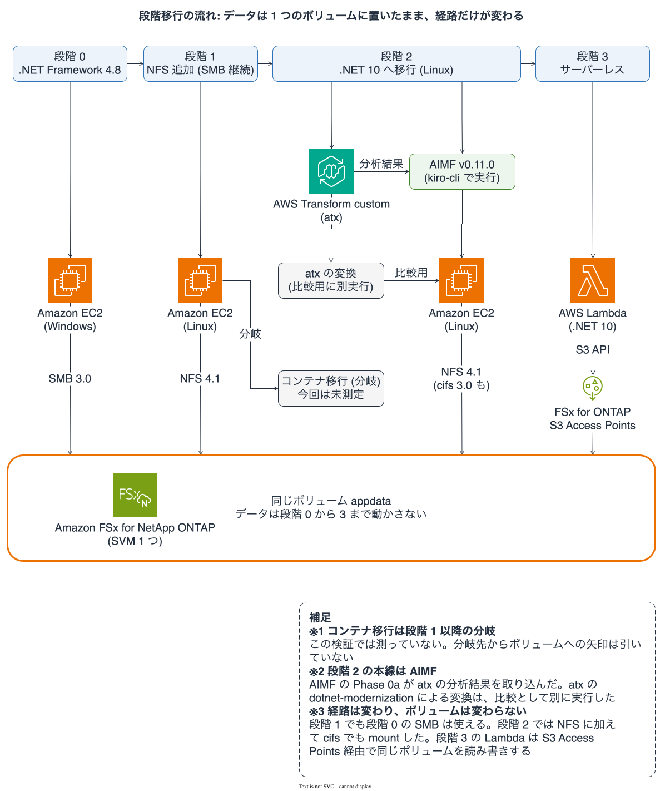

# 再現手順: 段階 0 から 3 までを順に再現する

> 証拠区分: この文書は手順書で、各手順の結果は[段階 0](stage-0-smb-ntfs.md)、[段階 1](stage-1-multiprotocol.md)、
> [段階 2](stage-2-aimf-modern-dotnet.md)、[段階 3](stage-3-s3-access-points.md)、[検証環境](environment.md)の
> 実測値に依る。コマンドのうちリポジトリのスクリプトを使うものは、`--help` と各スクリプトの冒頭コメントに
> 合わせて書いた。2026-10-13 時点で、公開した `scripts/measure/` のドライバ、`scripts/fetch-prices.py`、
> `app/modern/` を、削除済みの環境に対して再実行してはいない（単体テストと静的検査は通っている）。
> 「再構成」と付けた手順は、実行記録のメモから組み立てた手作業で、スクリプトにしていない。
> ID は `fs-0123456789abcdef0`、`123456789012`、`<management-ip>` のような置き換えで書く。

Amazon FSx for NetApp ONTAP（以下 FSx for ONTAP）の 1 つのボリュームを使い、Windows 上の .NET Framework アプリを
Linux 上の .NET、さらに AWS Lambda へモダナイズする検証（2026-10-07 から 2026-10-12、ap-northeast-1）を、公開済みの
スクリプトとアプリで再現する順序をまとめる。再現した結果が元の記録と一致することは約束しない。
一致しない理由の候補は「再現できないこと」に書く。

## 再現できる範囲と再現できない範囲

| 項目 | 公開リポジトリから再現できるか | 手段 | 限界 |
|---|---|---|---|
| 基盤スタックの作成と削除 | できる | `scripts/estimate.py`、`scripts/deploy.sh`、`scripts/teardown.sh` | 見積りの単価は取得日で変わる。ONTAP の版は作るたびに違いうる |
| ONTAP 側の設定と境界記録 | できる | `scripts/ontap/*`、`scripts/check-invariant.py` | ホストへの配置と結果の回収は手作業（再構成） |
| 旧アプリのビルドと Probe（Windows と Linux の cifs・NFS） | 一部できる | `app/legacy`、`scripts/run-probe.sh` | Windows 側のビルドとランチャーの配置は手作業（再構成） |
| 8 組のクロスホスト計測 | できる | `scripts/run-probe.sh`、`scripts/measure/pairs.py`、`scripts/probe_merge.py` | 各組 1 回の観測。同じ数値にはならない |
| 近代化後アプリのビルドとテスト | できる | `app/modern`、`make app-modern` | macOS と SDK 10.0.400 での 54 件の合格を 1 回確認した |
| 近代化後アプリを Linux ホストへ配置 | 条件つき | `scripts/measure/ship_build.py` | 差分送信は、ホストに前回のビルドがあるときだけ実用になる。初回の送信は S3 経由で、スクリプトにしていない |
| Worker の出力比較（旧 Worker と近代化 Worker） | できる | `scripts/measure/host/run-worker.sh`、`windows/*.ps1`、`compare_worker_out.py` | Windows の 2 本は ssm_run.py から直接は渡せない（「既知の制約」） |
| AIMF のセッション | 手順は再現できる | `scripts/aimf/*`、kiro-cli | 出力は決定的でない。承認用のスクリプトは公開しない |
| AWS Transform custom（atx）の 2 変換 | 手順は再現できる | `scripts/aimf/run-atx.sh` | 出力と agent minutes は実行ごとに違う |
| 段階 3（Lambda と S3 Access Points） | できる | `app/modern/src/DocIntake.Lambda`、`scripts/deploy.sh stage3`、`scripts/measure/lambda_invoke.py` | `lambda_invoke.py` はこの形では未実行 |
| 見積りの価格ファイル | できる | `scripts/fetch-prices.py` | フィルタの値は実環境で再確認していない |
| 実額の帰属（Cost Explorer） | できる | 「実額の帰属方法」の節 | 値は `Estimated: true` で請求書ではない。共用アカウントでは、タグとリソース ID で帰属できない費用（AD など）が残る |
| 請求額（請求書） | できない | なし | 請求書の値は取得していない |

## 前提とするアカウント・ツール・版

AWS 側の前提は次のとおり。

- ap-northeast-1 で FSx for ONTAP、AWS Managed Microsoft AD、EC2、Lambda、Systems Manager、Secrets Manager、
  CloudFormation、S3 を作れるアカウントと権限。必要な権限の最小集合は検証していない
- IAM Identity Center（SSO）のログイン済みセッション。`Token has expired` になったら読者が `aws sso login` を実行する。
  スクリプトは別の認証経路を試さない。長期のアクセスキーは作らない
- 検証用に新しく作るファイルシステム。既存の本番ボリュームには使わない

手元の端末に入れるツールは次のとおり。版はその根拠のある場所を併記する。

| ツール | 版 | 根拠 |
|---|---|---|
| Python | 3.12 以上（CI は 3.12） | `.github/workflows/ci.yml` |
| ruff、cfn-lint | 0.16.7、1.56.3 | `requirements-dev.txt`（`make install`） |
| markdownlint-cli2 | 0.22.1 | `ci.yml` |
| gitleaks | 8.30.1 | `ci.yml` |
| cfn-guard | 3.2.0 | `ci.yml` |
| shellcheck | 版は固定していない | `ci.yml`（apt のパッケージ） |
| .NET SDK | 10（ビルドは 10.0.400 で確認） | `make app-modern` が 10 系以外を拒否する |
| AWS CLI | v2（`--cli-binary-format` を使う） | 2026-10-13 時点でバージョンは記録していない |
| kiro-cli | 2.29.1（V2 エンジンの対話モード） | [段階 2](stage-2-aimf-modern-dotnet.md) |
| atx | 3.18.0 | [段階 2](stage-2-aimf-modern-dotnet.md) |
| AIMF | v0.11.0 | `scripts/aimf/setup-workspace.sh` が固定する |
| tmux | 版は記録していない | AIMF セッションの駆動に使った |
| pandoc | 3.12.1（AIMF の準備で導入した） | 2026-10-12 の準備記録 |

atx は AWS Transform custom の CLI で、ap-northeast-1 のレジストリに 2 つの変換が載っていることを
2026-10-10 に確認した。kiro-cli の利用にはクレジットが要る。

## 全体の流れと run id の命名

各段階は前の段階の構成の上に積む。1 つのボリューム `appdata` を最後まで動かさない。

| 段階 | 実行するもの | 得られるもの | 記録の置き場所 |
|---|---|---|---|
| 準備 | `fetch-prices.py`、`estimate.py`、`deploy.sh base` | 基盤スタック `appmod-base` | `.private/estimates/`、`.private/runs/approval.json` |
| 0 | `ontap/stage0-smb.sh`、旧アプリのビルド、`run-probe.sh --stage 0` | 境界記録 `b0`、Probe 4 組の統合結果 | `.private/runs/s0-<UTC>/` |
| 1 | `ontap/stage1-nfs.sh`、`run-probe.sh --stage 1` | 境界記録 `b1`、8 組の統合結果 | `.private/runs/s1-<UTC>/` |
| 2 | atx の 2 変換、AIMF セッション、`app/modern` の配置と計測 | ADR、近代化後アプリ、Linux の Probe と Worker の結果 | `.private/aimf/`、`.private/runs/s2m-<UTC>/` ほか |
| 3 | `deploy.sh stage3`、`lambda_invoke.py` | `appmod-stage3`、Lambda の worker と probe の結果、`b3` | `.private/runs/s3m-<UTC>/` |



ダーク版: [SVG](../_assets/images/appmod-stage-flow-dark.svg) / [PNG](../_assets/images/png/appmod-stage-flow-dark@2x.png)。ライト版の PNG: [PNG](../_assets/images/png/appmod-stage-flow@2x.png)。

図が示す内容は次の表と同じで、図にしか書かれていない事実はない。

| 段階 | 実行環境 | 経路 | ボリュームへの到達 |
|---|---|---|---|
| 0 | Windows EC2、.NET Framework 4.8 | SMB 3.0 | 同じボリューム `appdata` |
| 1 | 段階 0 に Linux EC2 を追加。SMB も継続 | NFS 4.1 | 同じボリューム `appdata` |
| 2 | Linux EC2、.NET 10。AIMF v0.11.0 を kiro-cli で実行し、atx の分析結果を入力にした | NFS 4.1 と cifs 3.0 | 同じボリューム `appdata` |
| 3 | AWS Lambda、.NET 10 | S3 API から FSx for ONTAP S3 Access Points | 同じボリューム `appdata` |
| 分岐 | コンテナ化（段階 1 以降の分岐） | この検証では測っていない | 矢印は引いていない |

atx の dotnet-modernization による変換は、AIMF とは別に比較用として実行した。AIMF の Phase 0a は atx の分析結果を取り込んだ。データは段階 0 から 3 まで動かさず、変わるのは経路である。

run id は `s<段階の数字>[英小文字 0 から 2 字]-<UTC の YYYYMMDDTHHMMSSZ>` の形にする。ドライバとホスト側のスクリプトは、
この形に合わない値を拒否する。UTC 部分は `date -u +%Y%m%dT%H%M%SZ` で作る。

| 接頭辞 | 意味 |
|---|---|
| `s0`、`s1` | 旧 Probe による段階 0 と段階 1 の計測 |
| `s0w` | 旧 Windows Worker を 1 回動かして作った `out/s0/` の基準 |
| `s2`、`s2f`、`s2g` | atx の変換結果を Linux で動かした記録（比較用） |
| `s2m` | AIMF 由来の近代化後アプリの Probe、Worker、8 組のクロスホスト |
| `s2n` | ADR-3 に合わせた acl-evaluation の記録形の再計測 |
| `s3`、`s3b`、`s3m` | 段階 3。`s3b` は case-sensitivity の再計測、`s3m` は AIMF 由来のコード |
| `s4c` | 陽性対照つきの case-sensitivity を Windows SMB、Linux cifs、Linux NFS で測った run |

## 作業リポジトリの準備

```bash
git clone https://github.com/Yoshiki0705/FSx-for-ONTAP-App-Modernization-Patterns.git
cd FSx-for-ONTAP-App-Modernization-Patterns
make install
make all > /tmp/all.log 2>&1; echo $?
```

`make all` は Python、シェル、CloudFormation、Markdown の静的検査と単体テスト、`app/modern` のビルドとテストを
回す。ツールが欠けていると、その検査は失敗する。結果は終了コードで読み、パイプには通さない。

`.private/` は gitignore されている作業領域で、見積り、承認記録、実行記録、AIMF のワークスペースを置く。
ここにはアカウント ID やインスタンス ID が入るので、公開リポジトリへ送らない。

`scripts/create-secrets.sh` と `scripts/aimf/setup-workspace.sh` は、`-h` または `--help` で使い方を表示し、
それ以外の引数には、パスや AWS の呼び出しより前に終了コード 2 で終わる。初回は `APPMOD_DRY_RUN=1` を付けて、実行される内容を確かめる。

## 見積りと承認と基盤の作成

課金を伴う操作の前に、見積りを作り、人が承認し、その承認記録とつないで実行する。見積りは作成から 24 時間を過ぎると
`deploy.sh` が拒否し、使った見積りは `.private/estimates/used/` へ移るので 2 度目の操作には使えない。

1. 価格ファイルを取り直す。Price List API の読み取りだけを行い、ファイルに SKU と取得日を残す。単価は変わるので、承認のたびに取り直す。

   ```bash
   python3 scripts/fetch-prices.py --set all --out .private/estimates/fixtures/prices.json
   ```

   `--set` は `base`、`atx`、`stage3`、`all` を取る。1 つのキーに価格が一意に決まらないときは終了コード 3 で止まり、
   候補を表示する。`--explain <キー>` でそのキーの候補だけを見られる。実際の値が参照値から 10 倍以上離れると
   終了コード 4 になる。SSO の期限切れは終了コード 20。

2. 最小のストレージとスループットのファイルを書く。値は FSx for ONTAP のクォータの文書で、第 1 世代 Single-AZ の
   現在の最小値を読んで書く。この文書の数値を写さない。テンプレートの固定値（1,024 GiB、128 MBps）と合わなければ、
   `estimate.py` が終了コード 4 で止まる。

   ```bash
   printf '{"storage_gib": 1024, "throughput_mbps": 128}\n' > .private/estimates/fixtures/minimums.json
   ```

3. 見積りを作る。`--price-fixture` は `--help` に「tests only」とあるが、ライブの取得経路が実装されていないため、
   実際の見積りでもこの引数が必要になる（引数なしは終了コード 1）。

   ```bash
   python3 scripts/estimate.py --target base --hours 72 --egress-mode endpoints \
     --price-fixture .private/estimates/fixtures/prices.json \
     --minimums-fixture .private/estimates/fixtures/minimums.json
   ```

   `.private/estimates/<UTC>-base.json` と Markdown の要約ができる。構成、所要時間、費用を読み、承認するかを決める。
   承認の判断は人が行う。

4. 承認を `.private/runs/approval.json`（JSON の配列）に 1 件追記する。`approved_at` は承認した時刻で、
   見積りの `created_at` より前にはできない。

   ```json
   {
     "target": "base",
     "approved_at": "2026-10-13T00:00:00Z",
     "hours": 72,
     "estimate_file": ".private/estimates/<UTC>-base.json"
   }
   ```

5. シークレット 4 つを作る。パスワードは生成され、コマンドラインに出ない。`APPMOD_DRY_RUN=1` を付けると、作らずに呼び出しだけを表示する。

   ```bash
   APPMOD_DRY_RUN=1 bash scripts/create-secrets.sh
   bash scripts/create-secrets.sh
   bash scripts/preflight.sh --phase network
   bash scripts/preflight.sh --phase secrets
   ```

6. 基盤スタックを作る。

   ```bash
   bash scripts/deploy.sh base --estimate .private/estimates/<UTC>-base.json --approved-at 2026-10-13T00:00:00Z
   ```

   `base.yaml` は 51,200 バイトを超えるため、`deploy.sh` はデプロイ用バケット `appmod-deploy-<account-id>-ap-northeast-1` に
   テンプレートを置いて `--template-url` で作る。このバケットは `teardown.sh` が触れず、再構築のために残る。
   2026-10-07 の作成は約 33 分だった（1 回の観測、[検証環境](environment.md)）。

7. 以降で使う値をスタックの出力から読む。

   ```bash
   aws cloudformation describe-stacks --region ap-northeast-1 --stack-name appmod-base \
     --query 'Stacks[0].Outputs[].[OutputKey,OutputValue]' --output text
   ```

   `FileSystemId`、`ArtifactsBucketName`、`WindowsClientInstanceId`、`LinuxClientInstanceId`、`SvmNetBiosName`、
   `LinuxRoleArn` などが出る。以降の例では `<windows-instance-id>`、`<linux-instance-id>`、`<artifacts-bucket>` と書く。

## 段階 0 の実施手順

段階 0 は、Windows の .NET Framework 4.8 アプリが NTFS ボリュームを SMB で使う出発点を作り、Probe の 5 つの挙動を基準として記録する。
結果の読み方は[段階 0](stage-0-smb-ntfs.md)にある。

ONTAP のスクリプトは Linux ホストで動く。スクリプトのホストへの配置は、`teardown.sh` が `scripts/ontap/` を成果物バケットへ置き、
Systems Manager 経由で動かすのと同じ形で行う（再構成）。

1. ONTAP のスクリプトを成果物バケットへ置く。

   ```bash
   mkdir -p .private/runs/s0-<UTC>
   aws s3 cp --recursive --region ap-northeast-1 scripts/ontap/ s3://<artifacts-bucket>/scripts/ontap/
   ```

2. AD ユーザー `appsvc` と `appreader` を Windows ホストで作る（スクリプト）。引数は既定値で足りる。

   ```bash
   python3 scripts/measure/ssm_run.py --instance <windows-instance-id> --platform windows \
     --script scripts/create-ad-users.ps1 --comment "create AD users" \
     --out .private/runs/s0-<UTC>/ad-users.json
   ```

3. SMB 共有、NTFS ACL、`seed/`・`probe/`・`out/` のディレクトリを Linux ホストで設定する（スクリプト + 再構成のラッパー）。
   ドメインコントローラーが発見済みでなければ、スクリプトは終了コード 4 で止まる。その場合は環境を作り直す。

   ```bash
   cat > .private/runs/s0-<UTC>/ontap-stage0.sh <<'EOF'
   #!/bin/bash
   set -euo pipefail
   mkdir -p /opt/appmod/ontap
   aws s3 cp --recursive --region ap-northeast-1 "s3://${APPMOD_ARTIFACTS_BUCKET}/scripts/ontap/" /opt/appmod/ontap/
   bash /opt/appmod/ontap/stage0-smb.sh --file-system-id "${APPMOD_FS_ID}"
   EOF
   python3 scripts/measure/ssm_run.py --instance <linux-instance-id> --platform linux \
     --script .private/runs/s0-<UTC>/ontap-stage0.sh \
     --env APPMOD_ARTIFACTS_BUCKET=<artifacts-bucket> --env APPMOD_FS_ID=fs-0123456789abcdef0 \
     --comment "stage0 ontap" --out .private/runs/s0-<UTC>/ontap-stage0.json
   ```

4. 合成データ `seed/` を作ってボリュームへ置く。作成はスクリプトで、置く手順は再構成である。
   `appsvc` の SMB セッションを張った Windows ホストから `\\APPMODSVM01\appdata\seed` へ複製した（2026-10-11）。

   ```bash
   python3 scripts/make-seed.py --out .private/seed
   ```

5. Linux ホストへランチャーと Probe を置く（再構成）。`scripts/probe-launch.sh` と `scripts/probe_peer.py` を成果物バケット経由で
   `/opt/appmod/` へ置く。実行記録では、`mount.cifs` が使えること、Python 3 が入っていることを確かめた。
   ランチャーは SMB を `/mnt/appdata-smb` へ、`sec=ntlmssp`、`vers=3.0` でマウントする。

6. Windows ホストへ旧アプリを置いてビルドする（再構成）。`app/legacy` を成果物バケットの `build-src/` へ置き、
   Windows ホストで取得し、.NET Framework 同梱の MSBuild でビルドした。

   ```bash
   aws s3 cp --recursive --region ap-northeast-1 app/legacy/ s3://<artifacts-bucket>/build-src/
   ```

   ```powershell
   Read-S3Object -BucketName <artifacts-bucket> -KeyPrefix build-src/ -Folder C:\appmod\src
   & C:\Windows\Microsoft.NET\Framework64\v4.0.30319\MSBuild.exe C:\appmod\src\DocIntake.sln /p:Configuration=Release
   ```

   ビルドは終了コード 0 で、警告 MSB3644 と MSB3270 が出た（2026-10-11。実行記録は 2026-10-07 と同じ無害な警告と判断した）。
   Probe の出力を `C:\appmod\DocIntake\` へ複製し、`scripts/probe-launch.ps1` を `C:\appmod\` へ置く。

7. 目録を取る。Windows 側は `scripts/inventory.ps1`、Linux 側は NFS の段階 1 以降で `scripts/inventory.sh` を使う。
   `inventory.ps1` は必須のパラメータ `-SharePath` を取るので、ssm_run.py に直接は渡せない（「既知の制約」の回避策を使う）。

8. 境界記録 `b0` を取り、ロックが無いことを確かめる（スクリプト）。2 本とも Linux ホストで動く読み取り専用のスクリプトで、
   手順 3 と同じラッパーの形で `/opt/appmod/ontap/` から呼ぶ。`record-boundary.sh` はホストの
   `.private/runs/<run-id>/b0.json` に書き、`--windows-inventory` には手順 7 で取った Windows の目録を渡す。
   ホストの出力を作業端末の `.private/runs/<run-id>/` へ回収する手順は、スクリプトにしていない。

   ```bash
   bash /opt/appmod/ontap/record-boundary.sh --boundary b0 --run-id s0-<UTC> \
     --file-system-id fs-0123456789abcdef0 --windows-inventory <windows-inventory.json>
   bash /opt/appmod/ontap/check-no-locking.sh --file-system-id fs-0123456789abcdef0
   ```

9. Probe を実行する（スクリプト）。Windows と Linux の 2 台で、段階 0 の 4 組を動かす。

   ```bash
   bash scripts/run-probe.sh --stage 0 --run-id s0-<UTC> \
     --windows-instance <windows-instance-id> --linux-instance <linux-instance-id> \
     --bucket <artifacts-bucket>
   ```

   結果は `.private/runs/s0-<UTC>/merged.json` に統合される。

## 段階 1 の実施手順

同じボリュームに NFS を足す。複製や作り直しはしない。セキュリティスタイルは `ntfs` のまま。結果の読み方は[段階 1](stage-1-multiprotocol.md)にある。

1. export policy、UNIX ユーザー、name mapping を設定する（スクリプト）。2 回目の実行は全オブジェクトが既存で、変更なしに終わる。
   `--client-cidr` はプライマリサブネットの CIDR。成果物バケットに `scripts/ontap/` を置いてあるので、段階 0 と同じラッパーの形で動かす。

   ```bash
   bash /opt/appmod/ontap/stage1-nfs.sh --client-cidr <primary-subnet-cidr> --file-system-id fs-0123456789abcdef0
   ```

2. Linux ホストで NFS をマウントする（再構成）。実行記録の形は次のとおり（`<svm-dns>` は SVM の NFS の DNS 名）。

   ```bash
   mount -t nfs4 <svm-dns>:/appdata /mnt/appdata -o vers=4.1,sec=sys,proto=tcp,hard
   ```

   root は匿名に潰されるため、`ls` を root で実行すると拒否される。ボリュームは UNIX ユーザー uid 10001 で読む
   （`setpriv --reuid=10001 --regid=10001 --clear-groups`）。
3. 目録を取り、`b1` を記録し、`check-invariant.py` で `b0` と比べる。
4. Probe を実行する。NFS を加えた 3 辺と 8 組になる。

   ```bash
   bash scripts/run-probe.sh --stage 1 --run-id s1-<UTC> \
     --windows-instance <windows-instance-id> --linux-instance <linux-instance-id> \
     --bucket <artifacts-bucket>
   ```

## 結果の読み方

Probe の結果、段階 0 との比較、単一ボリュームの不変条件、記録の有効性を、この順に読む。

### 統合結果

`run-probe.sh` と `pairs.py` は、各ホストの記録を `probe_merge.py` で `merged.json` にまとめる。

```bash
python3 scripts/probe_merge.py --out-dir .private/runs/<run-id> --run-id <run-id> --stage <N> \
  --sides "windows linux-smb linux-nfs" --pairs .private/runs/<run-id>/pairs-manifest.tsv
```

file-locking と write-visibility は、2 台が同じ同期 ID を持ち、時刻の重なりが記録で確かめられた組だけが `cross-host` になる。
読者が見るのは `topology` の値ではなく、統合後の `reasons` が空かどうかである。

### 段階 0 との比較

```bash
python3 scripts/compare-probe.py --baseline .private/runs/<s0-run-id>/merged.json \
  --result .private/runs/<run-id>/merged.json
```

| 終了コード | 意味 |
|---|---|
| 0 | すべての挙動で判定が出た（`ok`、`differs`、`skipped`、`error`、`no-baseline` など） |
| 1 | 両方が `topology` を名乗る記録の間で `topology` が一致しない（設定の誤り） |
| 2 | コマンドラインの誤り |
| 3 | case-sensitivity の記録のどれかに陽性対照（`observed.real_resolved` が true）がない。判定は `invalid` |

終了コード 3 は、対照のない計測を結論に使わないための停止で、`ok` と書かれていても根拠にならない。段階 0 と段階 1 の旧 Probe の
case-sensitivity が実例である。トポロジーの不一致と陽性対照の欠落が同時に起きた run は、終了コード 1 になる。

### 単一ボリュームの不変条件

```bash
python3 scripts/check-invariant.py --baseline .private/runs/<s0-run-id>/b0.json \
  --boundary .private/runs/<run-id>/b2.json
```

検査する不変条件は 3 つ。ボリュームの UUID が `b0` と同じこと、`seed/` の目録（相対パス、サイズ、SHA-256）が同じこと
（`b1` 以降は Windows と Linux の目録も互いに一致すること）、最上位のパスが `seed/`・`probe/`・`out/` だけであること。
違反は終了コード 1。参照した目録が解決できない場合や、ハッシュが合わない場合、空の目録も違反として扱う。

### 記録の有効性

| run | 有効性 |
|---|---|
| `s0-20261011T065443Z`、`s1-20261011T075058Z` | case-sensitivity 以外は有効。case-sensitivity は陽性対照がなく無効 |
| `s4c-20261012T034403Z`、`s3b-20261012T022900Z` | case-sensitivity の有効な計測（各 1 回） |
| `s2-*`、`s2f-*`、`s2g-*` | atx 由来のコード。比較用で、本線の移行ではない |
| `s0w-20261012T102314Z`、`s2m-20261012T090934Z`、`s2n-20261012T104314Z`、`s3m-20261012T104800Z` | 有効（各 1 回） |

## 段階 2 の実施手順

段階 2 は、AWS Transform custom（atx）の 2 変換、AIMF のセッション、近代化後アプリの Linux での計測からなる。
近代化後アプリの計測は、公開済みの `app/modern` で再現できる。AIMF のセッションを再実行しなくても測れる。
セッションの出力は決定的でないので、再実行した結果は `app/modern` と一致しない。

### atx の 2 変換

atx は agent minutes で課金される。変換の名前と上限は、承認した見積りだけから読まれる。

1. 見積りを作り、承認を `approval.json` に記録する。

   ```bash
   python3 scripts/estimate.py --target atx --transformation AWS/comprehensive-codebase-analysis \
     --limit-minutes 120 --price-fixture .private/estimates/fixtures/prices.json
   ```

   2 つ目の変換は `--transformation AWS/dotnet-modernization --limit-minutes 300`。`approval.json` の記録には
   `target`、`approved_at`、`estimate_file` に加えて `transformation` と `limit_minutes` を書いた。
2. 呼び出しの検証記録を `.private/runs/atx-invocation-verified-<変換名>.json` に置く。`run-atx.sh` は、この記録の
   `invocation`、`transformation`、`limit_minutes`、`region` が見積りと一致し、`atx_version` と `verified_at` があるときだけ進む。
   記録は `atx --version`、`atx custom def list --json`、`atx custom def exec --help` の出力を確かめて手で書いた。
3. 送るディレクトリを用意し、実行する。分析の対象は `.private/aimf/DocIntake`（`setup-workspace.sh` が作る）。
   `AWS/dotnet-modernization` はコードを書き換えるため、コミット済みの別の複製だけで動く。複製は、リポジトリのルートで 1 回作る
   （`run-atx.sh` の冒頭コメントにある手順）。

   ```bash
   mkdir -p .private/aimf/DocIntake-atx-dotnet
   git archive --format=tar HEAD:app/legacy | tar -x -C .private/aimf/DocIntake-atx-dotnet
   git -C .private/aimf/DocIntake-atx-dotnet init -q
   git -C .private/aimf/DocIntake-atx-dotnet add -A
   git -C .private/aimf/DocIntake-atx-dotnet -c user.name=appmod -c user.email=appmod@example.com commit -q -m "init: DocIntake sample from Spoke app/legacy"
   ```

   ```bash
   bash scripts/aimf/run-atx.sh --estimate .private/estimates/<UTC>-atx.json --approved-at <ISO 8601>
   ```

   終了コードは 0（完了）、1（失敗。見積りは保持）、2（送る前に拒否）、3（上限で停止。課金されたものとして見積りを消費）。
   結果は 2026-10-11 に、分析が 92.46 agent minutes、dotnet-modernization が 139.00 agent minutes だった（各 1 回、[段階 2](stage-2-aimf-modern-dotnet.md)）。

### 近代化後アプリのビルド

```bash
cd app/modern
dotnet build DocIntake.sln -c Release
dotnet test DocIntake.sln -c Release
dotnet publish src/DocIntake.Probe  -c Release -r linux-x64 --self-contained true -o <probe-publish-dir>
dotnet publish src/DocIntake.Worker -c Release -r linux-x64 --self-contained true -o <worker-publish-dir>
```

自己完結の公開物は 1 つあたり約 81 MB だった（SDK 10.0.400、1 回の観測）。詳細は [app/modern/README.md](../../app/modern/README.md)（英語）。

### Linux ホストへの配置

`ship_build.py` は、ホストに前回のビルドがあるとき、差のあるファイルだけを Run Command で送り、新しいディレクトリに組み立てて検証する。
ホストの既存ディレクトリは消さず、宛先がすでにあれば拒否する。

```bash
python3 scripts/measure/ship_build.py --instance <linux-instance-id> --run-id s2m-<UTC> \
  --component probe=<probe-publish-dir> --component worker=<worker-publish-dir> \
  --base probe=/opt/appmod/<earlier-build>/probe --base worker=/opt/appmod/<earlier-build>/probe \
  --dest-dir /opt/appmod/modern --executable probe/DocIntake.Probe \
  --executable worker/DocIntake.Worker --prune-extra
```

`--base` なしでは全ファイルを送り、24,000 文字ずつの Run Command で約 4,500 回になるため、`--max-chunks`（既定 200）を超えると終了コード 3 で拒否する。
初回の配置は、公開物を tar にして成果物バケットへ置き、ホストで取得して展開する（再構成。この形では実行していない）。
`--dry-run` はホストの差分を読まないので、計画は全送信の上限になる。

ホストのランチャーに `APPMOD_PROBE_BIN`（近代化後の Probe を直接呼ぶ指定）を効かせるには、ホスト上の `probe-launch.sh` を
リポジトリの最新版に置き換える。ホストのものは複製で、更新しないと変数が無視される。

### Probe の計測

1. Linux の standalone（NFS を uid 10001 で、続いて cifs を root で）を動かす。ホストのファイルは消さず、移動もしない。

   ```bash
   mkdir -p .private/runs/s2m-<UTC>
   python3 scripts/measure/ssm_run.py --instance <linux-instance-id> --platform linux \
     --script scripts/measure/host/standalone-probe.sh \
     --env APPMOD_RUN_ID=s2m-<UTC> --env APPMOD_STAGE=2 \
     --env APPMOD_PROBE_BIN=/opt/appmod/modern/probe/DocIntake.Probe \
     --comment "s2m standalone" --out .private/runs/s2m-<UTC>/linux-raw.json
   ```

   出力は `===NFS-BEGIN===` と `===NFS-END===`、`===SMB-BEGIN===` と `===SMB-END===` で区切られ、`nfs-exit=N`、`smb-exit=N` が付く。
   区切りの間の JSON を `linux-nfs.json`、`linux-smb.json` として `.private/runs/s2m-<UTC>/` へ保存する。この分割は手作業で、スクリプトはない。
2. Windows の standalone を動かし、続いて 8 組を動かす。

   ```bash
   python3 scripts/measure/pairs.py --run-id s2m-<UTC> --stage 2 \
     --windows-instance <windows-instance-id> --linux-instance <linux-instance-id> \
     --bucket <artifacts-bucket> windows-standalone
   python3 scripts/measure/pairs.py --run-id s2m-<UTC> --stage 2 \
     --windows-instance <windows-instance-id> --linux-instance <linux-instance-id> \
     --bucket <artifacts-bucket> \
     --linux-probe-bin /opt/appmod/modern/probe/DocIntake.Probe pairs
   ```

   `pairs` は 1 組ずつ順に動かし、最初の問題（失敗した状態、JSON なし、`error`、陽性対照が解決しない case-sensitivity）で止まる。
   自動のやり直しはなく、保存済みのファイルは上書きしない（終了コード 2）。終了時に `probe_merge.py` のコマンドを表示するが、実行はしない。
   段階 0 では 5 から 8 の組は指定できない。この run では Windows 側は旧ビルド（.NET Framework 4.8）のままにし、Linux 側だけを近代化後のビルドにした。
   Windows の Probe を既定の `C:\appmod\DocIntake\DocIntake.Probe.exe` 以外に置いたときは、`--windows-probe-exe` でそのパスを渡す。
3. 表示された `probe_merge.py` のコマンドで統合し、`compare-probe.py` で段階 0 と比べる。

### Worker の出力比較

旧 Windows Worker を 1 回動かして `out/s0/` の基準を作り、近代化後の Worker を別の段階名で動かし、出力を比べる。
段階名を取り違えると基準を上書きするため、スクリプトは次の 2 つの確認を持つ。

- Linux 側（`run-worker.sh`）: `APPMOD_WORKER_STAGE` が未設定または形式違いなら終了コード 3。`out/<stage>` が既にあれば終了コード 4（何も動かさない）。
  Worker の既定の段階が `s0` なので、未設定のまま動かすと基準に書く。
- Windows 側（`run-worker.ps1`）: 設定ファイルの `Stage` と `SmbRoot` が引数と一致すること、`out\<Stage>` が無いことを、SMB のマッピングを張る前に確かめる。

手順は次のとおり。

1. 旧 Windows Worker を動かす。2 本の PowerShell は必須のパラメータを取り、ssm_run.py はパラメータを渡せないので、
   「既知の制約」の回避策のラッパーを経由する（再構成。この形では未実行）。`prep-worker.ps1` が実行用のディレクトリを作り、
   `run-worker.ps1 -ExeDir <dir> -Stage s0` が動かす。`out\s0` が既にあれば動かない。
2. 近代化後の Worker を Linux で動かす（NFS、uid 10001）。

   ```bash
   python3 scripts/measure/ssm_run.py --instance <linux-instance-id> --platform linux \
     --script scripts/measure/host/run-worker.sh \
     --env APPMOD_WORKER_BIN=/opt/appmod/modern/worker/DocIntake.Worker \
     --env APPMOD_WORKER_STAGE=s2m --env APPMOD_REF_STAGES=s0 \
     --comment "s2m worker" --out .private/runs/s2m-<UTC>/worker.json
   ```

3. 読み取り専用で `out/` を読み出し、手元で復元して比べる。

   ```bash
   python3 scripts/measure/ssm_run.py --instance <linux-instance-id> --platform linux \
     --script scripts/measure/host/read-out.sh --env APPMOD_STAGES=s0,s2m \
     --comment "read out" --out .private/runs/s2m-<UTC>/read-out.json
   python3 scripts/measure/collect_out.py --dump .private/runs/s2m-<UTC>/read-out.json \
     --out-dir .private/runs/s2m-<UTC>/out
   python3 scripts/measure/compare_worker_out.py --a .private/runs/s2m-<UTC>/out/s0 \
     --b .private/runs/s2m-<UTC>/out/s2m
   ```

   終了コード 0 は、`index.json` の順序つき JSON の同値、レポートごとの sha256 の一致、（`--seed-expected` と `--dump` を渡したとき）`seed/` の一致がすべて成り立ったとき。
   ADR-4 により `index.json` のバイト列は変わる（元の run では 201 バイトと 181 バイト）。JSON の同値で比べる。
4. 境界 `b2` を取り、`check-invariant.py` で `b0` と比べる。

### ADR-3 の記録形の再計測

`s2n` は、acl-evaluation を ADR-3 の記録の形で測り直した run で、`standalone-probe.sh` を別の run id で動かして得た。Linux の NFS と cifs で
`precheck` が `skipped`、`precheck_reason` が空でなく、`io_can_write` が true になる。

## AIMF セッションの手順

AIMF は、AI エージェントに決められた段階で移行を進めさせるワークフローである。2026-10-12 に 1 回だけ実施した。
手順は再現できるが、出力は同じにならない。

### 準備

1. ワークスペースを作る。AIMF v0.11.0 を固定コミットで取得し、`app/legacy` の複製を作り、`dotnetfw-to-modern-dotnet` の playbook を入れ、
   3 本の PreToolUse フックを 2 か所に配線し、gitleaks の送信前検査の自己テストと、記録リポジトリの remote が空であることの確認までを行う。

   ```bash
   APPMOD_DRY_RUN=1 bash scripts/aimf/setup-workspace.sh
   bash scripts/aimf/setup-workspace.sh
   ```

2. フックの配線を、セッションの前に毎回検査する。`install.sh` はエージェント設定を書き直すので、再検査が要る。

   ```bash
   python3 scripts/aimf/check-hook-wiring.py --workspace .private/aimf \
     --workspace-hook .private/aimf/.kiro/hooks/block-unilateral-worm-enablement.json \
     --agent-config .private/aimf/.kiro/agents/migration.json \
     --guard "$(pwd)/scripts/guard_irreversible_ops.py"
   ```

3. `fsxadmin` の読み取りを、段階 2 の間だけ Linux のインスタンスロールから止める。AIMF のエージェントが ONTAP の
   snapshot locking を有効にできる経路を塞ぐ。境界記録を取るときは読み取り専用の ONTAP ロール `appmod_readonly` を使う。

   ```bash
   APPMOD_LINUX_ROLE_ARN=<linux-role-arn> bash scripts/aimf/lock-fsxadmin.sh on
   ```

   セッションの後に `bash scripts/aimf/lock-fsxadmin.sh off` で戻す。`LinuxRoleArn` は `appmod-base` の出力にある。
4. 見積りの経過時間が基盤の承認時間の 80% 以内であることを確かめる。

   ```bash
   python3 scripts/estimate.py --elapsed
   ```

### 起動とカナリア

kiro-cli は V2 エンジンの対話モードで起動する。AWS の資格情報は環境変数で隔離する。非対話モードは使わない。

```bash
tmux new-session -d -s aimf -c .private/aimf \
  'env -u AWS_PROFILE AWS_CONFIG_FILE=/dev/null AWS_SHARED_CREDENTIALS_FILE=/dev/null AWS_EC2_METADATA_DISABLED=true kiro-cli chat --v2 --agent migration'
```

最初のターンでカナリアを走らせる。無害なコマンド、ブロック対象の合言葉 `appmod-canary-block` を含むコマンド、`use_aws` の `sts get-caller-identity` の 3 つを順に実行させ、
次を確かめる。

| 呼び出し | 期待する判定 |
|---|---|
| 無害な shell コマンド | allow |
| 合言葉を含む shell コマンド | block（コマンドが実行されず、合言葉が出力されない） |
| `use_aws sts get-caller-identity` | allow の判定が出て、資格情報の隔離により NoCredentials で失敗する |

呼び出しは `.private/aimf/hook-canary.log` に残る（`hook_canary.py` が書く）。2026-10-12 の kiro-cli 2.29.1 で、この 3 つの結果を 1 回確認した。

### 指示文と起動インタビューの回答

最初の指示文は、対象ソースの場所、既存の atx の分析結果を使うこと（Phase 0a は実行ではなく取り込み）、禁止事項を書く。

- 禁止: `aws` と `use_aws`（`sts` を除く）、`atx`、`git push`、`git remote` の追加と変更
- 読み取りも変更もしない場所: AIMF の取得物（`upstream/`）、比較用の複製（`DocIntake-atx-dotnet/`）
- 必要になったら止まって聞くこと、起動インタビューの未入力項目は 1 回の箇条書きで質問すること

インタビューの回答は 6 項目だった。

| 項目 | 回答の趣旨 |
|---|---|
| 移行の動機 | .NET Framework 4.8 のサンプルを新しい .NET に移し、データを FSx for ONTAP のボリュームに置いたまま Linux EC2 の NFS でも動かす |
| 作業ホスト | ローカルでよい |
| 記録リポジトリの remote | 設定しない。push しない |
| アセスメントのみか | 移行まで進む（Phase 0b へ） |
| 分析対象 | 1 つのリポジトリ。AIMF の取得物と比較用の複製は対象外 |
| staging ブランチ | そのままにする。`setup-modernized.sh` の base-ref に `master` を渡す |

### 人が止める点

セッションは、次の点でエージェントが止まり、人が判断した。2026-10-12 の 1 セッションの実績である。

| 点 | エージェントが出したもの | 人の判断 |
|---|---|---|
| ADR-1（移行先） | 選択肢つきの草案 | 選択肢 B に修正して承認。.NET 10、ストレージは NFS に加えて S3 Access Points をスコープに含める |
| ADR-2（非機能の範囲） | 草案を出して止まる | 範囲を決定として記録（ADR-2） |
| work-plan | 草案 | 4 点を修正して確定。検証を AIMF 内と AIMF 外に分け、smoke と integration をコンソールアプリ向けに作り替える |
| ADR-3（`CanWrite`） | Step 2 の前の草案 | 1 つ目の案を修正して承認。Linux は mode ビットでなく実 I/O で判定する |
| Step 1（`setup-modernized.sh`） | 実行後に止まり、SHA とブランチを報告 | 作業ツリーの origin の除去は人が行い、伝えるまで Step 2 に進まない |
| セキュリティスタイル | ADR の草案 | `ntfs` を維持。決定者は利用者 |

指示文では、プロトコルとセキュリティスタイルの変更を HOLD（人に返す点）とした。

### tmux からの駆動と承認の選別

対話セッションは tmux の中で動かし、`tmux capture-pane -p -J -t aimf -S -600` で画面を読み、`tmux send-keys -t aimf` で応答を送る。
承認の画面は「shell requires approval」と 3 択（Yes, single permission / Trust, always allow in this session / No）で、既定は先頭である。

承認は選別して返す。`Trust, always allow` は選ばない。これはセッション中の以後の承認を省く選択肢で、許可リストによる選別が効かなくなるためである。
フックが止めるのは WORM 系の操作と `atx` の直接実行だけで、それ以外の AWS の変更や `git push` はフックが止めない。
その部分を、指示文、資格情報の隔離、承認の選別、remote を設定しないことで補う。方針は次の表のとおり。

| 区分 | 内容 | 扱い |
|---|---|---|
| 自動で承認 | 読み取り専用の固定リストのコマンド（`ls`、`cat`、`head`、`tail`、`wc`、`grep`、`diff`、`stat`、`find`（`-delete` と `-exec` なし）、`git` の読み取り系など） | 単発の承認だけを返す |
| 自動で承認 | 記録リポジトリの 2 本のローカルスクリプト（`turn-report.sh`、`verify.sh`） | 単発の承認だけを返す |
| 自動で承認 | 記録リポジトリと実装ツリーの内側へのファイル書き込み、その内側での `git add`・`commit`・`rm`・`mv` | 単発の承認だけを返す |
| 人が判断 | `aws`、`use_aws`、`atx` | 止めて表示する |
| 人が判断 | ネットワーク系（`curl`、`wget`、`ssh`、`scp`）、パッケージ管理（`brew`、`npm`、`pip`） | 止めて表示する |
| 人が判断 | `rm`・`mv`・`cp`・`chown`・`sudo`・`kill`、`git push`・`clone`・`checkout`・`reset`・`rebase`・`merge`・`pull`・`fetch`、remote の追加と変更 | 止めて表示する |
| 人が判断 | `sed -i`、シェルへのパイプ、バッククォート、上記 2 つの木の外への書き込み | 止めて表示する |
| 人が判断 | AIMF の取得物と比較用の複製への読み取りと書き込み、サブエージェントの起動 | 止めて表示する |

承認用のスクリプト自体は公開しない。上の表が、公開する方針の全部である。自分で作る場合は、許可リストに載らないものを必ず人に返す形にする。
クレジットは各ターンの末尾に `Credits: turn X • session Y` と出る。上限は利用者が 5,000 に設定し、約 284 を使った。

### セッションの後

`fsxadmin` の遮断を `off` で戻し、記録リポジトリの remote が空であることを確かめる。記録リポジトリは公開しない。
公開するのは、`make audit` を通した表と要約だけである。

## 段階 3 の実施手順

Lambda から FSx for ONTAP S3 Access Points 経由で同じボリュームを読み書きする。結果の読み方は[段階 3](stage-3-s3-access-points.md)にある。

1. Lambda のパッケージを作り、成果物バケットの `lambda/worker.zip` に置く。

   ```bash
   cd app/modern
   dotnet publish src/DocIntake.Lambda -c Release -r linux-x64 --no-self-contained -o <lambda-publish-dir>
   (cd <lambda-publish-dir> && zip -qr ../docintake-lambda.zip .)
   unzip -l ../docintake-lambda.zip | grep DocIntake.Lambda.dll
   aws s3 cp ../docintake-lambda.zip s3://<artifacts-bucket>/lambda/worker.zip --region ap-northeast-1
   ```

   ランタイムは `dotnet10`。ハンドラが読む環境変数は `S3_ACCESS_POINT_ARN` と `ARTIFACTS_BUCKET` で、テンプレートが設定する。
2. 見積りを作って承認を記録し、スタックを作る。見積りは Lambda の要求、実行時間、CloudWatch Logs、S3 Access Points の要求を数え、基盤の時間は含めない。

   ```bash
   python3 scripts/estimate.py --target stage3 --hours 4 --invocations 6 \
     --price-fixture .private/estimates/fixtures/prices.json
   bash scripts/deploy.sh stage3 --estimate .private/estimates/<UTC>-stage3.json --approved-at <ISO 8601>
   ```

3. 境界 `b3` の前に、Lambda を起動する。worker は `out/s3/` に書く。probe は 5 つの挙動を S3 版で測り、成果物バケットの `probe/<run-id>/lambda-s3.json` にも JSON を置く。

   ```bash
   python3 scripts/measure/lambda_invoke.py --mode worker --run-id s3m-<UTC> --stack-name appmod-stage3 \
     --out-dir .private/runs/s3m-<UTC>
   python3 scripts/measure/lambda_invoke.py --mode probe --run-id s3m-<UTC> --stack-name appmod-stage3 \
     --bucket <artifacts-bucket> --out-dir .private/runs/s3m-<UTC>
   ```

   結果は `lambda-worker-result.json`、`lambda-probe-result.json`、`lambda-s3.json` に保存される。
   worker が非ゼロで終わるとハンドラは例外を投げるため、その場合は `lambda-<mode>-error.json` に残る（FunctionError）。
   スクリプトは EventBridge Scheduler のスケジュールに触れず、スケジュールは `DISABLED` のままである。
   `lambda_invoke.py` は文書のコマンドとハンドラの入力規則から書いたもので、この形では実行していない。実行記録は `aws lambda invoke` を直接使った。
4. 境界 `b3` を取り、`check-invariant.py` で `b0` と比べ、case-sensitivity の陽性対照が解決していることを確かめる。
   S3 のキーに `\` を入れてボリューム直下に書くと、SMB の最上位に 8.3 短縮名（`PROBES~1.TXT`）が現れて `check-invariant.py` が失敗する。
   `app/modern` の Probe は `probe/sep\check-s3.txt` を使うので直下には出ない（`s3m-20261012T104800Z`、1 回の観測）。
   すでに直下に作ってしまった場合の削除は書き込みなので、削除を行うスクリプトは公開していない。
5. スタック `appmod-stage3` を、基盤より先に削除する。削除の待機は 20 分を超えた（1 回の観測）。

## 時間と費用の見込み

次はすべて見積りか 1 回の観測で、請求書は観測していない。実額は 2026-10-13 に Cost Explorer を読んだ値（`Estimated: true`）で、タグとリソース ID で帰属できた範囲だけである（[検証環境](environment.md)）。

| 項目 | 値 | 根拠 |
|---|---|---|
| 基盤の見積り | 72 時間で $57.71（2026-10-11 の承認） | 承認記録。破棄は約 33.6 時間後 |
| 基盤の実額（タグで帰属できた分） | $21.18（FSx for ONTAP $12.03、EC2 $6.36、VPC $2.77、S3 $0.02。AD を除く） | Cost Explorer、2026-10-13 に読み取り、`Estimated: true`、Credit と Refund を除外 |
| 基盤の作成時間 | 約 33 分（2026-10-07、1 回） | [検証環境](environment.md) |
| atx の分析変換 | 92.46 agent minutes、約 $3.24 の見積り | 2026-10-11、$0.035 / agent minute |
| atx の dotnet 変換 | 139.00 agent minutes。無料枠内なら $0、枠外なら約 $4.87 | 2026-10-11。枠の残りは観測できない |
| AD の推定（2 回目の構築） | $4.80（見積り $4.91、−2%）。実額ではない | 差分法による推定。65.76 DC 時間 × 0.073 USD。1 回目には使えない（「実額の帰属方法」） |
| AWS Transform の実額 | Usage $3.62215、Credit −$3.6221、純額 0（2026-10-11、サービス単位） | Usage は 103.49 分相当で、atx の記録（92.46 分と 139.00 分、合計 231.46 分）と合わない。理由は未解明（[段階 2](stage-2-aimf-modern-dotnet.md)） |
| 段階 3 の各回の承認額 | $0.04、$0.01、$0.01 | 2026-10-11 と 2026-10-12 の承認記録 |
| Kiro のクレジット | 約 284（上限 5,000） | 2026-10-12 の 1 セッション |

クレジットは金額に換算していない。AIMF セッションの実時間は、人の承認と質疑の時間を含むため並べていない。

## 実額の帰属方法

> 証拠区分: 手順は `documented`（下の 2 つの出典）。値を得た読み取りは 2026-10-13、各 1 回で、そのコマンドは記録していない。
> 下のコマンドは API リファレンスに沿って組んだ雛形で、そのまま実行した記録ではない。

共用のアカウントでは、Cost Explorer のサービス単位の合計は、この検証の費用ではない。他の用途の分が混ざる。
本検証は、次の 2 つの帰属だけを実額として載せた。どちらにも載らない費用は、見積りと書き分ける。
3 つ目の差分法は帰属ではなく推定で、実額としては載せない。

1. タグで絞る。CloudFormation が付ける `aws:cloudformation:stack-name` は、AWS が付けるタグなので、Billing and Cost Management で
   コスト配分タグとして有効化しないと Cost Explorer に出ない（[Using AWS-generated tags](https://docs.aws.amazon.com/awsaccountbilling/latest/aboutv2/aws-tags.html)）。
   値にはスタック名（`appmod-base`、`appmod-stage3`）を指定する。
2. リソース ID で引く。`GetCostAndUsageWithResources` は、リソース ID でのグループ化か絞り込みが要る。
   Cost Explorer の設定でリソース単位のデータを有効にしておく必要があり、期間は直近 14 日以内、リソース単位の粒度は日次（EC2 だけ時間単位）である
   （[GetCostAndUsageWithResources](https://docs.aws.amazon.com/aws-cost-management/latest/APIReference/API_GetCostAndUsageWithResources.html)）。
   14 日を過ぎると引けないので、破棄の後は早めに読む。
3. 差分法で推定する。タグもリソース ID も付かないサービス（本検証では AWS Managed Microsoft AD）に使う。
   日次の使用量（`UsageQuantity`、本検証では `APN1-Std-MicrosoftAD-DC-Usage` の DC 時間）から、この検証が無い日の定常分（本検証では 2026-10-08 から 2026-10-10 の平均 95.72 DC 時間/日）を引き、
   残りに単価（0.073 USD/DC 時間）を掛ける。2026-10-11 の 41.40 と 2026-10-12 の 24.36 で合計 65.76 DC 時間となり、約 4.80 USD だった。
   - 仮定: 定常分が、この検証の期間も一定である。一致の確認として、期待値（2 DC × 稼働時間 ≒ 67.2 DC 時間）と比べる。本検証では 2% 以内だった
   - 成り立たない条件: 検証の直前に使用量が定常分から外れているとき。1 回目の構築（2026-10-07）は、2026-10-06 の使用量が 48.52 DC 時間で定常分の半分だったため、使えなかった
   - 結果はリソース単位の帰属ではなく推定で、「帰属できた行のみ」の合計には入れない

1 と 2 の読み取りでは、指標は `UnblendedCost`、`RECORD_TYPE` の Credit と Refund は除外する。結果の `Estimated` が `true` の間は請求確定前の値である。
Credit の行を見るときだけ除外を外し、`RECORD_TYPE` でグループ化する（下の 4）。

```bash
# 1. タグで絞る（サービス別、日次）
cat > /tmp/ce-filter.json <<'JSON'
{"And": [
  {"Tags": {"Key": "aws:cloudformation:stack-name", "Values": ["appmod-base", "appmod-stage3"]}},
  {"Not": {"Dimensions": {"Key": "RECORD_TYPE", "Values": ["Credit", "Refund"]}}}
]}
JSON
aws ce get-cost-and-usage --time-period Start=2026-10-11,End=2026-10-13 --granularity DAILY \
  --metrics UnblendedCost --filter file:///tmp/ce-filter.json \
  --group-by Type=DIMENSION,Key=SERVICE

# 2. リソース ID で引く（SERVICE の値は aws ce get-dimension-values --dimension SERVICE で調べる）
aws ce get-cost-and-usage-with-resources --time-period Start=2026-10-11,End=2026-10-13 --granularity DAILY \
  --metrics UnblendedCost \
  --filter '{"And": [{"Dimensions": {"Key": "SERVICE", "Values": ["<SERVICE の値>"]}}, {"Not": {"Dimensions": {"Key": "RECORD_TYPE", "Values": ["Credit", "Refund"]}}}]}' \
  --group-by Type=DIMENSION,Key=RESOURCE_ID

# 3. 差分法に使う日次の使用量（定常分の日を含む期間を読む）
aws ce get-cost-and-usage --time-period Start=2026-10-08,End=2026-10-13 --granularity DAILY \
  --metrics UsageQuantity \
  --filter '{"Dimensions": {"Key": "USAGE_TYPE", "Values": ["APN1-Std-MicrosoftAD-DC-Usage"]}}'

# 4. Credit の行を見る（除外の絞りを付けず、RECORD_TYPE でグループ化する）
aws ce get-cost-and-usage --time-period Start=2026-10-11,End=2026-10-13 --granularity DAILY \
  --metrics UnblendedCost \
  --filter '{"Dimensions": {"Key": "SERVICE", "Values": ["<SERVICE の値>"]}}' \
  --group-by Type=DIMENSION,Key=RECORD_TYPE
```

- 期間の `End` は含まれない。2026-10-11 と 2026-10-12 の 2 日を読むには `End=2026-10-13` と書く。日付は UTC
- 稼働時間は、スタックイベントの作成開始と削除完了の時刻から数える。本検証は約 33.6 時間だった
- 見積りとの比較は、見積りの時間単価に稼働時間を掛けた値と、タグで帰属できた実額を行ごとに並べる。AD のようにリソース ID もタグも付かない費用は、見積りに差分法の推定を並べ、「帰属不可、推定」と書く
- AWS Transform のようにタグで帰属できないサービスは、サービス単位の値を別に示す。共用アカウントの合計なので、この検証だけの費用とは書かない。Credit の行が同額で付いていれば、純額も書く（本検証の AWS Transform は純額 0）。ほかのクレジットは調べていないと書く
- 結果の `Estimated` を載せる。請求書の値とは書かない

## 後片付けの手順

削除は課金から抜ける出口である。既定は報告だけで、AWS を呼ばない。`--apply` を付けたときだけ、固定の順序で削除する。

```bash
bash scripts/teardown.sh --file-system-id fs-0123456789abcdef0 --linux-instance <linux-instance-id> \
  --bucket <artifacts-bucket> --windows-role <windows-role-name>
bash scripts/teardown.sh --apply --file-system-id fs-0123456789abcdef0 --linux-instance <linux-instance-id> \
  --bucket <artifacts-bucket> --windows-role <windows-role-name> --svm appmodsvm
```

- `--svm` には SVM の名前を渡す。`svm-` で始まる ID を渡すと、何も呼ばずに終了コード 2 で拒否する
- 順序は、ロックが無いことの確認、`appmod-stage3` の削除、S3 Access Points の関連付けが 0 件であることの確認、一時クローンの掃除、`appdata` の削除、
  成果物バケットを空にする、Windows ロールのインラインポリシーの削除、`appmod-base` の削除、シークレット 4 つの削除、API の列挙による不在確認
- 手順 11 の Cost Explorer での課金停止の確認は翌日に人が行う
- デプロイ用バケット `appmod-deploy-<account-id>-ap-northeast-1` は、`teardown.sh` が意図して残す。使い終えたら、中身を一覧で確かめてから運用者が削除する
- `make pr-verify` はこのリポジトリのマージの関門で、再現には要らない
- `APPMOD_DRY_RUN` を `--apply` と併せて付けると、AWS を呼ばずに、実引数つきの呼び出しを順に表示する

> **FSx for ONTAP の制御プレーン API は ONTAP の状態に遅れて追従するので、残存の確認は方法を選ぶ。** 制御プレーン（`aws fsx describe-volumes`）は、ONTAP 側で作成・削除したボリュームを数分〜数十分遅れて反映する。経路 D の観測では、Trident が作ったボリュームが作成の 11〜26 分後に制御プレーンに現れ、削除の 41〜44 分後に消えた（いずれも 1 回の観測、`field-observation`。保証ではなく時間幅で、運用者が撤去のタイムアウトを設計する目安）。`aws fsx` だけを読む残存確認は、削除直後にまだ存在するものを「消えた」と読んだり、消えたものをまだ一覧に出したりしうる。`teardown.sh` は捕捉した ID で削除し、SVM を消す前にボリュームが制御プレーンから消えるのを待つ。非ルートのボリュームが制御プレーン上に見えている間は `delete-storage-virtual-machine` が拒否されるためである。ポーリングを始める前に、削除コマンドの終了コードを確認する。制御プレーンより早く確実さが要るときは、`aws fsx` だけでなく VPC 内から ONTAP の REST API を読む。

## 再現できないこと

- ONTAP の版は動く。最初の構築（2026-10-07）は 9.19.1P2、再構築（2026-10-11）は 9.19.1P3 だった。新しく作るファイルシステムは、別の版になりうる。
- atx と kiro-cli の出力は決定的でない。atx の agent minutes、AIMF の ADR とコード、台帳の項目は、再実行で変わる。`app/modern` は 2026-10-12 のセッションの出力であり、再実行の出力と一致しない。
- 計測値のほとんどは各 1 回の観測で、write-visibility の遅れ（約 8 秒と 100 ms 未満）のような値は同じにならない。形が再現するかどうかを見る。
- 請求書と、無料枠の残りは観測できない。
- 初回の Linux 向け自己完結ビルドの前回分（`ship_build.py --base` が参照するホスト上のディレクトリ）は、公開物にない。初回の配置は S3 経由の再構成の手順になる。
- 料金ページの動的タブや Price List の SKU は変わる。`fetch-prices.py` は取得日を記録するが、過去の値を再現するものではない。

## 既知の制約

- `scripts/measure/ssm_run.py` は PowerShell のスクリプトにパラメータを渡せない（`--env` は `$env:APPMOD_*` を設定するだけで、値の文字種も `\` を含まない範囲に限る）。
  `scripts/measure/windows/prep-worker.ps1`、`windows/run-worker.ps1`、`scripts/inventory.ps1` は必須のパラメータを取る。
  回避策は、スクリプト本体を `& { ... }` で包んで引数を書いたラッパーを作り、そのラッパーを `--script` に渡すこと。この形は未実行である。

  ```bash
  mkdir -p .private/runs/s0w-<UTC>
  { echo '& {'; cat scripts/measure/windows/prep-worker.ps1; echo '} -SourceDir "C:\appmod\src\src\DocIntake.Worker\bin\Release" -DestDir "C:\appmod\DocIntake-worker"'; } \
    > .private/runs/s0w-<UTC>/prep-call.ps1
  python3 scripts/measure/ssm_run.py --instance <windows-instance-id> --platform windows \
    --script .private/runs/s0w-<UTC>/prep-call.ps1 --comment "prep worker" \
    --out .private/runs/s0w-<UTC>/prep.json
  ```

- ホストへのランチャー、Probe、ONTAP のスクリプト、`seed/` の配置と、ホストで書いた境界記録や目録の作業端末への回収、standalone の出力の分割は、スクリプトにしていない。
- 初回の自己完結ビルドの配置と、ボリューム直下の `\` 入りファイルの削除は、スクリプトにしていない。
- `scripts/create-secrets.sh` と `scripts/aimf/setup-workspace.sh` は `-h/--help` 以外の引数を取らない。初回は `APPMOD_DRY_RUN=1` を先に使う。
- `estimate.py` の `--price-fixture` は、ヘルプが「tests only」と書くが、ライブの価格取得がないため実運用でも必要になる。
- `fetch-prices.py` のフィルタの値（EC2 の License Included、CloudWatch Logs の取り込みなど）は、実環境の Price List で再確認していない。
  一意に決まらなければ終了コード 3 で止まり、候補を表示する。
- 公開した PowerShell のスクリプトは、PowerShell のパーサーで構文を確かめただけで、どのゲートも実行しない。
- `app/legacy`（.NET Framework 4.8）はどのゲートもビルドしない。`app/modern` だけをビルドする。
- `app/modern` のソースのコメントには、非公開の記録を指す台帳ラベル（`AP-n`、`MP-n`、`ADR-n`）と、解決できないコミット参照が残る。
- 単体テストはテストダブルで動き、実環境での動作の証拠にならない。公開した `scripts/measure/` の各ドライバは、実環境で 1 回通すまで `hypothesis` として扱う。
- 必要な IAM 権限の最小集合は検証していない。
